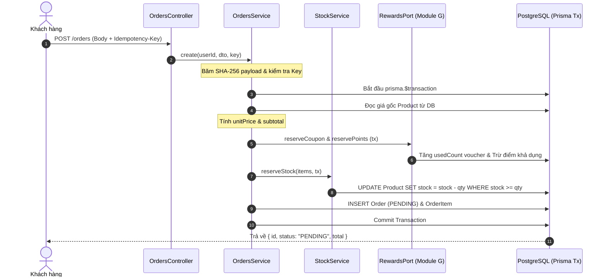
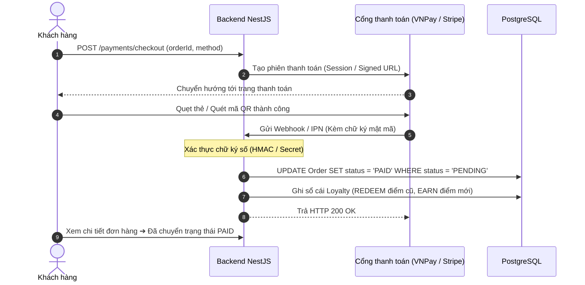
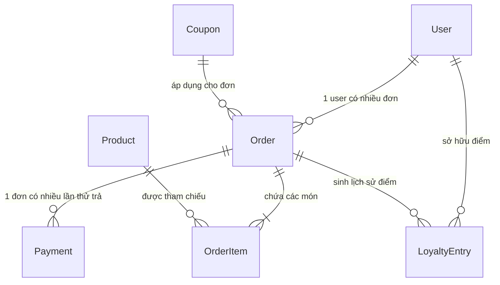

# 🗺️ BrewLite — Cẩm Nang Thuyết Minh & Giải Thích Sơ Đồ (Diagrams Guide)

> [!IMPORTANT]
> **Hướng dẫn chỉ tay vào sơ đồ (Cheat Script):** Giúp bạn tự tin mở slide hoặc file vẽ sơ đồ, chỉ chuột vào từng khối/mũi tên và thuyết minh gãy gọn, chuyên nghiệp nhất.

---

## 📑 Danh Mục Sơ Đồ Trọng Tâm
1. [Sơ đồ 1: Kiến trúc hệ thống (System Architecture)](#sơ-đồ-1-kiến-trúc-hệ-thống-system-architecture)
2. [Sơ đồ 2: Triển khai Docker (Deployment Diagram)](#sơ-đồ-2-triển-khai-docker-deployment-diagram)
3. [Sơ đồ 3: Use Case toàn hệ thống](#sơ-đồ-3-use-case-toàn-hệ-thống)
4. [Sơ đồ 4: Luồng tuần tự tạo đơn & Khóa kho (Sequence Diagram)](#sơ-đồ-4-luồng-tuần-tự-tạo-đơn--khóa-kho-sequence-diagram)
5. [Sơ đồ 5: Luồng thanh toán & Webhook (Payment Sequence)](#sơ-đồ-5-luồng-thanh-toán--webhook-payment-sequence)
6. [Sơ đồ 6: Mô hình dữ liệu quan hệ (ERD)](#sơ-đồ-6-mô-hình-dữ-liệu-quan-hệ-erd)

---

## Sơ Đồ 1: Kiến Trúc Hệ Thống (System Architecture)

* **📍 Vị trí file:** `docs/erd-latex/SystemArch.tex` (hoặc ảnh SVG trong `docs/diagrams/`)
* **🎯 Mục đích:** Trả lời *"Hệ thống gồm những thành phần nào và kết nối với nhau ra sao?"*

```mermaid
flowchart LR
    Browser["Trình duyệt (React UI)"]
    Cart["Zustand (LocalStorage)"]
    Next["Next.js App Router (:3000)"]
    Nest["NestJS Modular Monolith (:3001)"]
    DB[("PostgreSQL 16 (:5432)")]
    Gateways["Stripe / VNPay / Mock"]

    Browser -->|Tải trang UI| Next
    Browser <-->|Lưu trữ giỏ hàng| Cart
    Browser -->|REST API + Bearer JWT| Nest
    Nest -->|Prisma Client (ACID)| DB
    Nest <-->|API / Webhook IPN| Gateways
```

### 👆 Chỉ tay & Thuyết minh:
> *"Thưa thầy cô, kiến trúc hệ thống gồm 3 tầng chính:*
> 1. ***Client Layer:*** *Trình duyệt tải giao diện từ Next.js App Router (port 3000), giỏ hàng được quản lý offline-first bằng Zustand lưu ở LocalStorage.*
> 2. ***Server Layer:*** *Các request gọi API đi thẳng từ trình duyệt sang NestJS API (port 3001) kèm Bearer JWT. Backend chia 5 module nghiệp vụ nhưng chạy chung 1 tiến trình để đảm bảo tốc độ và sự đơn giản.*
> 3. ***Data Layer:*** *NestJS tương tác với PostgreSQL qua Prisma ORM với các transaction nguyên tử, tích hợp cổng thanh toán ngoài qua Webhook."*

> [!WARNING]
> **Điểm bẫy:** Request API từ Client đi **trực tiếp** tới NestJS (:3001) qua `NEXT_PUBLIC_API_URL`, không phải Next.js làm proxy cho mọi request.

---

## Sơ Đồ 2: Triển Khai Docker (Deployment Diagram)

* **📍 Vị trí file:** `docs/erd-latex/Deployment Diagram.tex`
* **🎯 Mục đích:** Trả lời *"Hệ thống đóng gói và chạy trong môi trường thực tế như thế nào?"*

### 👆 Chỉ tay & Thuyết minh:
> *"Toàn bộ hệ sinh thái được container hóa bằng **Docker Compose** với 3 dịch vụ chính:*
> - *Service `db` (Postgres 16): Chạy trên port 5432, dữ liệu gắn với Named Volume `dbdata` để không bị mất khi restart container.*
> - *Service `backend`: Đợi DB healthy thì mới tự động chạy `prisma migrate deploy` và `db seed`, sau đó expose port 3001.*
> - *Service `frontend`: Ứng dụng Next.js build production expose port 3000.*
> *Hệ thống có cấu hình HTTP Healthcheck cho cả Frontend và Backend để đảm bảo sẵn sàng phục vụ."*

---

## Sơ Đồ 3: Use Case Toàn Hệ Thống

* **📍 Vị trí file:** `docs/erd-latex/Usecase.tex`
* **🎯 Mục đích:** Trả lời *"Có những tác nhân nào và họ làm được những gì?"*

### 👆 Chỉ tay & Thuyết minh:
> *"Hệ thống phục vụ 3 nhóm tác nhân (Actors):*
> 1. ***Khách vãng lai (Guest):*** *Xem thực đơn, xem chi tiết món, chọn size/topping, quản lý giỏ hàng tạm thời và Đăng ký/Đăng nhập.*
> 2. ***Khách hàng (Customer - kế thừa Guest):*** *Tạo đơn hàng, áp dụng Voucher, đổi điểm thưởng, thanh toán không tiền mặt và theo dõi lịch sử đơn hàng.*
> 3. ***Quản trị viên (Admin):*** *Theo dõi dashboard doanh thu, cập nhật tiến độ pha chế đơn hàng theo State Machine và quản lý tồn kho sản phẩm."*

---

## Sơ Đồ 4: Luồng Tuần Tự Tạo Đơn & Khóa Kho (Sequence Diagram)

* **📍 Vị trí file:** `docs/FLOW-04-Coupon-Validation-Loyalty-Reserve-Finalize.drawio`
* **🎯 Mục đích:** Trả lời *"Khi khách bấm 'Đặt hàng', bên trong Backend diễn ra những bước gì?"*



### 👆 Chỉ tay & Thuyết minh:
> *"Đây là trọng tâm kỹ thuật của dự án. Khi tạo đơn:*
> 1. *Server băm SHA-256 payload để kiểm tra tính duy nhất qua **Idempotency Key**.*
> 2. *Toàn bộ quá trình giữ chỗ được gom trong **1 Database Transaction duy nhất**.*
> 3. *Server tự tính lại giá từ DB (không tin client).*
> 4. *Giữ chỗ Voucher, tạm trừ điểm thưởng và trừ kho nguyên tử `WHERE stock >= qty`.*
> 5. *Chỉ khi tất cả các bước thành công thì đơn hàng `PENDING` mới được tạo; nếu hết hàng hoặc lỗi, toàn bộ sẽ rollback về trạng thái ban đầu."*

---

## Sơ Đồ 5: Luồng Thanh Toán & Webhook (Payment Sequence)

* **📍 Vị trí file:** `docs/diagrams/` (Payment flow)
* **🎯 Mục đích:** Trả lời *"Xử lý thanh toán và xác nhận đơn hàng thế nào?"*



### 👆 Chỉ tay & Thuyết minh:
> *"Điểm cốt lõi ở đây là: **Không dùng kết quả ở trình duyệt để chốt tiền**. Trình duyệt chỉ nhận Return URL để điều hướng UI. Việc chốt đơn thành `PAID` và cộng điểm thưởng chỉ diễn ra khi Backend nhận được **Webhook / IPN chính thức từ cổng thanh toán đã được xác thực chữ ký số**."*

---

## Sơ Đồ 6: Mô Hình Dữ Liệu Quan Hệ (ERD)

* **📍 Vị trí file:** `docs/ERD-02-Order-Payment-Coupon-Loyalty.drawio`
* **🎯 Mục đích:** Trả lời *"Dữ liệu được tổ chức và liên kết thế nào trong PostgreSQL?"*



### 👆 3 Điểm nhấn thiết kế CSDL cần nói ngay:
1. **Bảng `OrderItem` snapshot giá:** Lưu cứng `unitPrice` và `lineTotal`. Nếu tương lai chủ quán tăng giá cà phê thì hóa đơn cũ của khách trong quá khứ không bị sai lệch.
2. **Quan hệ `Order` ➔ `Payment` là 1 : N:** Không phải 1 : 1, vì khách có thể quẹt thẻ thất bại lần 1 (`PAYMENT_FAILED`) rồi quẹt lại lần 2 (`SUCCEEDED`) trên cùng một đơn hàng.
3. **Bảng `LoyaltyEntry` là sổ cái bất biến (Ledger):** Lưu vết rõ ràng từng biến động điểm (`EARN`, `REDEEM`, `REFUND`) gắn liền với `orderId`, có ràng buộc duy nhất `(orderId, kind)` để chống cộng thưởng trùng lặp.
