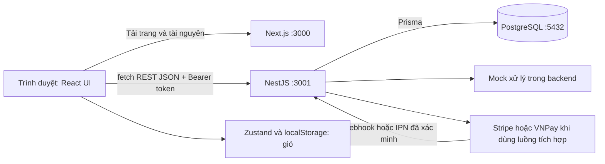
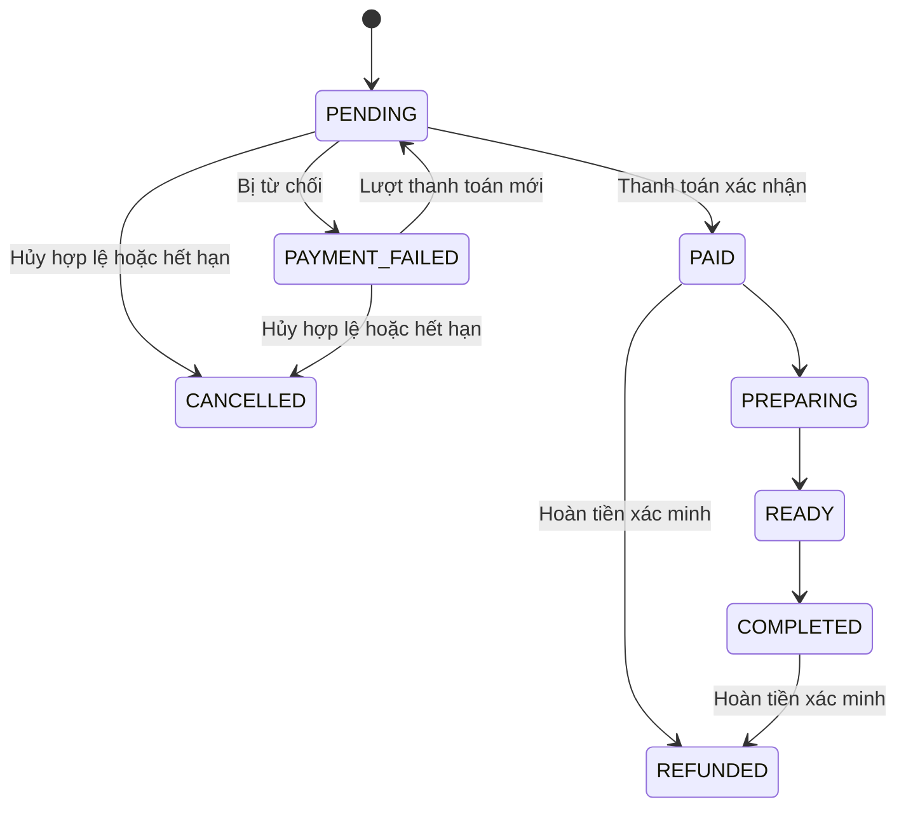

# BrewLite — Học toàn bộ dự án để thuyết trình và bảo vệ

Đối chiếu ngày 03/11/2026, trên nền commit `d88731d` và các thay đổi local đang có. Tài liệu này giải thích hành vi trong source, không coi mọi câu trong báo cáo cũ là tính năng đã hoàn thành.

## Đọc bộ tài liệu này theo thứ tự nào?

1. Đọc tài liệu này để hiểu hệ thống, nghiệp vụ và cách phát triển.
2. Đọc [Giải thích từng sơ đồ](GIAI-THICH-SO-DO-BREWLITE.md), mở file sơ đồ tương ứng và tập chỉ từng mũi tên.
3. Tự trả lời [Bộ câu hỏi bảo vệ](HOI-DAP-BAO-VE-BREWLITE.md), rồi mới xem đáp án.

Mục tiêu là trả lời được bốn câu cho mỗi chức năng: **nhận gì → xử lý ở đâu → lưu/thay đổi gì → nếu lỗi hoặc gửi lại thì sao**. Cách này hữu ích hơn học thuộc tên framework.

## 1. Kể dự án trong một phút

> BrewLite là hệ thống đặt đồ uống không dùng tiền mặt. Khách xem menu, chọn size và topping, thêm vào giỏ trên trình duyệt, đăng nhập rồi tạo đơn. Backend tính lại giá từ cơ sở dữ liệu, giữ tồn kho cùng ưu đãi và lưu đơn chờ thanh toán. Thanh toán thành công mới xác nhận đơn đã trả tiền và cộng điểm thưởng. Nếu thanh toán thất bại, khách có thể thử lại trên cùng đơn. Hệ thống còn có lịch sử đơn và trang quản trị để theo dõi, quản lý sản phẩm, kho và quá trình pha chế.
>
> Frontend dùng Next.js; backend dùng NestJS chia module; dữ liệu dùng PostgreSQL qua Prisma. Nhóm chọn một backend có các module rõ trách nhiệm để dễ chia việc và giữ giao dịch dữ liệu nhất quán.

Ba điểm kỹ thuật nên chủ động trình bày: **server quyết định giá**, **đặt đồng thời không được bán vượt kho**, **gửi lại yêu cầu không được tạo thêm đơn hoặc cộng thưởng lặp**.

## 2. Đừng nhầm phiên bản tài liệu và phân công

PDF `BrewLite-HuongDan-ChiTiet.pdf` ban đầu chia theo frontend/backend: B làm API sản phẩm, C làm menu, D làm chi tiết/giỏ, E làm đơn và đăng nhập. Bảy PDF **GUIDE-V2** chuyển sang chia theo thành phần nghiệp vụ. Repo hiện dùng cách thứ hai:

| Người | Thành phần | Sở hữu chính | Phối hợp |
|---|---|---|---|
| A | Platform / Integration | Môi trường, Docker, CI, contract, schema/migration chung, ghép và nghiệm thu | Tất cả |
| B | Catalog | API sản phẩm, menu, chi tiết, chọn size/topping, giá xem trước | Gọi API store của C |
| C | Cart | Zustand, giỏ, số lượng, khóa biến thể, lưu trình duyệt, badge | B đưa món vào; F xóa giỏ sau xác minh |
| D | Identity | Đăng ký, đăng nhập, bcrypt, JWT, Guard, CurrentUser | E/F/G dùng danh tính đã xác thực |
| E | Ordering | Tạo/đọc/hủy đơn, snapshot giá, kho, máy trạng thái, chống tạo trùng | G giữ ưu đãi; F báo kết quả trả tiền |
| F | Payments | Thanh toán, phiên checkout, retry/idempotency, webhook/IPN, UI liên quan | E quản trạng thái; G ghi thưởng |
| G | Rewards | Coupon, giữ và hoàn điểm/quota, sổ điểm và cộng thưởng | Chạy trong transaction E/F truyền vào |

Đây là **bảy vai trò phát triển**, không phải bảy máy chủ hay bảy microservice. Một thành viên có thể làm cả frontend và backend của phần mình. Không tự nhận A–G là tên thật của các tài khoản Trello.

PDF ghi tình trạng Foundation ngày 15/10, các TODO hoặc đề xuất như `PROCESSING`/lease là ảnh chụp thời điểm thiết kế. Không dùng chúng để khẳng định source ngày 03/11 vẫn chưa làm hoặc có đúng những field đó.

## 3. Kiến trúc và đường đi thực tế của request



**Monorepo** nghĩa là frontend và backend nằm cùng repository, chung lịch sử Git và tài liệu. **Modular monolith** nghĩa là backend là một ứng dụng triển khai chung, bên trong chia module. Hai khái niệm nói về hai vấn đề khác nhau.

Browser nhận UI từ Next.js nhưng các lời gọi API ở client đi trực tiếp tới NestJS qua `NEXT_PUBLIC_API_URL`. Không mô tả tất cả request đều được Next.js proxy. `localhost` trong browser là máy đang mở browser; `db` là hostname dùng trong mạng Docker, browser không tự hiểu hostname đó.

### Trong NestJS, mỗi tầng làm gì?

Ví dụ tạo đơn:

```text
HTTP request
  → Guard xác thực
  → Pipe kiểm tra DTO
  → OrdersController nhận tham số
  → OrdersService điều phối nghiệp vụ và transaction
  → StockService / RewardsPort xử lý phần chuyên trách
  → Prisma thực hiện truy vấn PostgreSQL
  → response JSON
```

- **Controller:** cửa vào HTTP; đọc body/header/param và gọi service. Không nên nhét toàn bộ công thức và transaction vào đây.
- **DTO:** xác nhận hình dạng dữ liệu: kiểu, tập giá trị, số lượng tối thiểu. DTO hợp lệ chưa bảo đảm đủ kho hoặc coupon còn quota.
- **Service:** kiểm tra nghiệp vụ và điều phối thao tác dữ liệu.
- **Module:** đăng ký controller/provider, import/export thứ các module khác cần.
- **Dependency Injection:** Nest tạo và truyền dependency qua constructor; dễ thay dependency bằng bản giả trong unit test.
- **Prisma:** ORM tạo truy vấn và kiểu dữ liệu từ schema; không tự suy ra luật giảm giá hay chống trùng của nhóm.
- **Port/public API:** điểm tích hợp ổn định giữa các phần, giảm việc đọc và sửa chéo implementation.

`public.ts` là cửa export theo quy ước repo, không phải một HTTP endpoint. `RewardsPort` là interface TypeScript; interface mất khi chạy JavaScript nên cần token runtime `REWARDS_PORT = Symbol(...)` cho DI. F cũng có `ORDERS_PAYMENT_PORT` với adapter. Adapter hiện tên `MockOrdersPaymentAdapter` nhưng thực sự truy vấn DB; không vì chữ Mock mà kết luận nó chỉ giữ dữ liệu trong RAM.

### Vì sao chọn cách này?

Đội nhỏ cần chia việc rõ nhưng tạo đơn phải phối hợp kho, coupon và điểm trong cùng PostgreSQL transaction. Một backend giúp làm điều này trực tiếp, vận hành đơn giản hơn hệ thống phân tán. Đổi lại, các module vẫn chung tiến trình và DB; ranh giới phải được giữ bằng thiết kế, review và kiểm tra import. Không khẳng định hệ thống tự mở rộng độc lập từng module như microservices.

## 4. Một ví dụ xuyên suốt để hiểu tiền, kho và điểm

Giả sử đồ uống giá gốc **45.000đ**, chọn M **+5.000đ**, một topping **+5.000đ**, mua hai ly. Coupon giảm 10%, dùng 5.000 điểm; trước đó khách có 8.000 điểm.

| Đại lượng | Phép tính | Kết quả |
|---|---|---:|
| `unitPrice` | 45.000 + 5.000 + 5.000 | 55.000đ |
| `lineTotal` | 55.000 × 2 | 110.000đ |
| `subtotal` | Tổng các lineTotal | 110.000đ |
| Giảm bằng coupon | floor(110.000 × 10%) | 11.000đ |
| Sau coupon | 110.000 − 11.000 | 99.000đ |
| `pointsRedeemed` | Điểm thực dùng | 5.000 |
| `discountTotal` trong code hiện tại | Coupon + điểm | 16.000đ |
| `Order.total` | subtotal − discountTotal | **94.000đ** |
| Điểm EARN khi đã trả tiền | floor(94.000 / 100) | **940 điểm** |

**Không trừ điểm lần hai khi tính total:** `discountTotal` đã bao gồm điểm. Đây là chỗ rất dễ nói sai do tên trường.

Diễn biến dữ liệu:

| Thời điểm | Kho | Số dư điểm | Coupon | Sổ LoyaltyEntry |
|---|---|---:|---|---|
| Mới thêm giỏ | Chưa đổi | 8.000 | Chưa giữ lượt | Chưa có |
| Chỉ xem trước coupon | Chưa đổi | 8.000 | Chỉ kiểm tra | Chưa có |
| Tạo đơn thành công | Giảm 2 | 3.000 | usedCount tăng 1 | Chưa ghi EARN/REDEEM cho đơn mới |
| Mock thanh toán bị từ chối | Vẫn giữ 2 | 3.000 | Vẫn giữ | Không cộng thưởng |
| Thử lại thành công | Không trừ thêm | 3.940 | Không giữ thêm lượt | REDEEM 5.000, EARN 940 |
| Hoặc hủy khi chưa trả tiền | Hoàn 2 | Trở về 8.000 | Trả lượt | Không có thưởng của đơn này |

Hàng thanh toán thành công và hàng hủy là **hai nhánh khác nhau**, không diễn ra nối tiếp. Hủy thông thường sau PAID bị chặn; hoàn tiền là quy trình riêng.

## 5. Module B — Catalog: xem và cấu hình món

Nguồn: `backend/src/products/`, `frontend/lib/products-api.ts`, `frontend/app/products/[id]/page.tsx`, trang menu.

`GET /products` lấy danh sách; `GET /products/:id` lấy một món, không có món trả 404. Tên class thực là `ProductsController`, `ProductsService`; đường dẫn hiện không có prefix `/api`. ID sản phẩm là số nguyên.

Frontend quản lý loading, empty, error, not-found; hiển thị ảnh/tên/giá/kho, tìm kiếm và lọc trên dữ liệu nhận được. Phân loại trên UI đang suy từ tên món; schema chưa có bảng Category riêng. API lỗi không được coi dữ liệu giả là sản phẩm thật để đặt.

Trang chi tiết khởi tạo size S, topping rỗng. Đổi lựa chọn tính lại **giá hiển thị**: S +0, M +5.000, L +10.000; mỗi topping +5.000. Topping được contract chấp nhận là `Trân châu`, `Kem`. Các tên khác trong báo cáo cũ chưa chắc hợp lệ với DTO hiện tại.

Khi bấm thêm, B gọi `add` của C. B không tạo Order hoặc trừ tồn kho. Kiểm tra `stock > 0` để khóa nút là hỗ trợ trải nghiệm; số tồn có thể thay đổi ngay sau lúc tải trang nên E vẫn phải kiểm tra tại DB.

**Cách nói:** “B cho khách xem và chọn món. Giá trên màn hình là dự kiến; việc chốt giá và giữ hàng thuộc Ordering.”

## 6. Module C — Cart: cấu hình mua tạm trên trình duyệt

Nguồn: `frontend/store/cart.ts`, `cart-rules.ts`, trang `/cart`.

CartItem chứa `productId`, `size`, `toppings`, `qty`, `unitPrice` phục vụ hiển thị. Khóa biến thể dựa trên **productId + size + danh sách topping đã loại trùng/sắp xếp**. Cùng sản phẩm size M và size L là hai dòng; cùng combo topping nhưng đảo thứ tự phải gộp thành một dòng.

Store có `add`, `remove`, `setQty`, `clear`, `count`, `total`. Badge là tổng số lượng, không phải số dòng. Ví dụ hai dòng qty 2 và 3 thì badge bằng 5. UI giới hạn qty 1–99; không được suy ra backend DTO cũng có giới hạn 99.

Zustand giữ state để component cập nhật. Middleware persist lưu items vào localStorage tên `brewlite-cart`; tổng và số lượng được tính lại. Dữ liệu khôi phục được kiểm tra/sanitize vì storage có thể cũ, hỏng hoặc bị sửa.

**Cart khác Order:** Cart sửa thoải mái và chưa giữ hàng; Order là bản ghi bền vững trên server, có chủ sở hữu, giá chốt, trạng thái và liên kết thanh toán. Không có `CartController`, `CartService` hay bảng Cart trong implementation hiện tại.

Giỏ trên localStorage không tự đồng bộ giữa các thiết bị hoặc tự gắn riêng theo tài khoản. Đây là đánh đổi của MVP. Khi đặt, chỉ gửi ID/tùy chọn/qty; giá ở localStorage không được dùng làm số tiền phải thu.

## 7. Module D — Identity: xác thực và cấp danh tính

Nguồn: `backend/src/auth/`, trang `/login`, `/register`, API client.

### Đăng ký

1. DTO kiểm tra email, mật khẩu tối thiểu 6 ký tự, có giới hạn độ dài.
2. Chuẩn hóa email trim và lowercase.
3. bcryptjs băm mật khẩu với cost 12; salt nằm trong định dạng hash bcrypt.
4. Tạo User, DB unique email ngăn hai tài khoản trùng cả khi request đồng thời.
5. Prisma lỗi P2002 được đổi thành 409; thành công chỉ trả `{id,email}`.

Hash là biến đổi một chiều để so sánh, không phải mã hóa có khóa giải ngược. Không trả passwordHash cho client. Register hiện không cấp JWT; UI có thể gọi login tiếp.

### Đăng nhập và gọi API

AuthService đọc user rồi `compare` mật khẩu với hash. Sai email hoặc sai mật khẩu cùng trả 401 với thông điệp chung. Đúng thì ký JWT chứa `sub`, `email`, có hạn 1 ngày theo cấu hình AuthModule. JWT có chữ ký để phát hiện sửa đổi; payload không được mã hóa.

Client gửi `Authorization: Bearer <token>`. Passport xác minh chữ ký/hết hạn; `JwtStrategy.validate` kiểm tra payload rồi chuyển `sub` thành `AuthUser.userId`. `@CurrentUser()` lấy danh tính đó từ request. Controller dùng `user.userId`, không dùng userId tùy ý trong body.

**Authentication:** ai đang gọi? **Authorization:** người đó có được làm thao tác này trên dữ liệu này không? Token hợp lệ không tự cho phép xem đơn người khác; E/F vẫn kiểm tra owner. Admin có lớp kiểm tra role DB riêng.

MVP lưu token trong localStorage nên script độc hại nếu chạy được trên trang có thể đọc token. Chưa có refresh-token/thu hồi phiên hoàn chỉnh. CORS và Helmet có ích nhưng không thay thế auth và kiểm soát dữ liệu.

## 8. Module E — Ordering: nơi chốt đơn và giữ tài nguyên

Nguồn: `orders.controller.ts`, `orders.dto.ts`, `orders.service.ts`, `stock.service.ts`, `order-state.ts`, `order-expiry.service.ts`.

### Input và các lớp kiểm tra

`POST /orders` cần JWT, `Idempotency-Key`, body như sau:

```json
{
  "items": [{"productId": 1, "size": "M", "toppings": ["Kem"], "qty": 2}],
  "couponCode": "GIAM10",
  "pointsToRedeem": 5000
}
```

ID và coupon trong ví dụ chỉ minh họa, cần dùng dữ liệu demo đang tồn tại. Body không chứa giá hay userId. Global ValidationPipe dùng whitelist, forbidNonWhitelisted và transform; trường lạ bị từ chối. DTO kiểm tra giỏ không rỗng, ID/qty nguyên dương, size và topping hợp lệ, điểm không âm. Sau DTO còn kiểm tra sản phẩm tồn tại, coupon, số dư và kho ở DB.

### Quy trình tạo đơn chính xác

1. Kiểm tra key bắt buộc, trim, tối đa 200 ký tự.
2. Chuẩn hóa payload, sắp topping, chuẩn hóa coupon; tính SHA-256 requestHash.
3. Tìm theo userId + key. Cùng hash trả đơn đã có; khác hash trả 409.
4. Bắt đầu transaction và kiểm tra trùng lại.
5. Đọc sản phẩm từ DB; nếu thiếu sản phẩm thì lỗi.
6. Tính unitPrice, lineTotal, subtotal từ Product.price và quy tắc server.
7. Nếu dùng ưu đãi, gọi G reserve coupon/điểm bằng chính `tx` đang mở.
8. Gọi StockService gom nhu cầu theo sản phẩm và giữ kho bằng cập nhật có điều kiện.
9. Tạo Order PENDING, OrderItem snapshot, tiền, key/hash, hạn thanh toán mặc định 30 phút.
10. Commit. Nếu lỗi thì rollback cả kho, điểm, coupon và đơn; nếu thua request trùng, tìm đơn thắng để trả lại khi hash khớp.

**Transaction** bảo đảm các thay đổi cùng thành công hoặc cùng hoàn tác. Không được gọi G với Prisma client độc lập nếu muốn nó rollback chung. Không phải cứ có transaction là mọi race condition tự biến mất.

### Chống bán vượt kho bằng OCC

Giả sử Product stock=3, version=7. Hai người cùng đọc và mỗi người muốn mua 2:

```sql
UPDATE "Product"
SET stock = stock - 2, version = version + 1
WHERE id = :id AND version = 7 AND stock >= 2;
```

Request đầu cập nhật được một hàng: stock=1, version=8. Request còn lại không còn khớp version/stock nên count=0 → conflict → rollback. Không có trường hợp cả hai đều lấy giá trị 3 rồi mỗi bên tưởng thành công.

Trong cùng giỏ, món cùng productId nhưng khác size/topping vẫn dùng chung Product.stock nên phải cộng qty trước. Cập nhật theo ID tăng dần giúp giảm nguy cơ deadlock khi đơn có nhiều sản phẩm; không phải lời bảo đảm tuyệt đối không có deadlock. StockService hiện báo 409 khi xung đột, không tự lặp vô hạn để giữ hàng.

Stock là **số đơn vị sản phẩm**, chưa phải quản lý gram cà phê, ml sữa hay công thức BOM. Size L hiện không tiêu thụ nhiều đơn vị kho hơn S; đó là giới hạn mô hình MVP.

### Snapshot và lịch sử

OrderItem.unitPrice/lineTotal giữ giá lúc đặt. Product đổi giá về sau không được làm tổng đơn cũ thay đổi. Tuy nhiên tên/ảnh sản phẩm đang đọc qua quan hệ Product; đây chưa phải snapshot toàn bộ nội dung sản phẩm. Không nói “mọi thông tin lịch sử đều bất biến”.

`GET /orders/me` chỉ lấy đơn user hiện tại, mới nhất trước. `GET /orders/:id` kiểm tra cả ID và owner; đơn người khác trả 404. Lịch sử không cần tạo lại từ giỏ localStorage.

### Trạng thái, hủy và hết hạn



Sơ đồ trên rút gọn đường nghiệp vụ thường dùng; bảng chuyển đầy đủ ở `order-state.ts` còn các đường REFUNDED khác. COMPLETED là hết quy trình nhận đồ uống, chưa phải trạng thái không thể chuyển nếu có extension hoàn tiền.

`advancePreparation` chỉ nhận PREPARING/READY/COMPLETED, kiểm tra thứ tự và CAS theo trạng thái cũ. Admin không được tùy ý set PAID. Bảng state có PAID→CANCELLED nhưng **luồng cancel hiện tại chỉ chấp nhận PENDING/PAYMENT_FAILED**. Phải thỏa cả luật trạng thái và điều kiện nghiệp vụ của thao tác.

Cancel khóa hàng Order bằng FOR UPDATE, kiểm tra owner và chặn nếu còn Payment PENDING. Sau đó CAS CANCELLED, hoàn kho, hoàn điểm/quota trong transaction. Bấm hủy hai lần không được hoàn hai lần. Nút hủy local đã nối `POST /orders/:id/cancel`; đây là thay đổi local, chưa mặc nhiên nằm trên remote.

Scheduler chạy mỗi phút, mỗi batch tối đa 50 đơn; có feature flag. Hạn mặc định không có nghĩa đúng giây thứ 1.800 là đơn chắc chắn bị hủy. Worker đọc hạn, trạng thái và phiên thanh toán còn hiệu lực rồi quyết định. Bản hiện tại dùng các field thời hạn phiên có sẵn; không có cột processingLeaseUntil như một sơ đồ cũ.

## 9. Module F — Payments: ý định trả tiền, kết quả và thử lại

Nguồn: `payments.controller.ts`, `mock-payment.service.ts`, `payments.service.ts`, `orders-payment.port.ts`, `stripe.provider.ts`, `vnpay/`, UI checkout và order-actions local.

### Phân biệt ba chế độ

| Luồng | API | Điều thực sự diễn ra |
|---|---|---|
| Mock local | POST /payments | Mô phỏng thành công/từ chối trong backend; không chuyển tiền ngân hàng |
| Stripe checkout | POST /payments/checkout với CARD/WALLET | Tạo/lấy lại phiên bên Stripe; browser sang trang được cung cấp |
| VNPay | POST /payments/checkout với VNPAY | Tạo URL có chữ ký, chuyển browser; IPN xác minh kết quả |

Config provider hiện là MOCK hoặc STRIPE; VNPay được phân nhánh theo method. Có source tích hợp không đồng nghĩa đã cấu hình merchant, callback công khai, live key và nghiệm thu tiền thật. Mock có thể minh họa xác nhận trả tiền; không nói rằng nút đó đã xác nhận quét QR ngân hàng thật.

### Hai loại key có mục đích khác nhau

- **Order key:** cùng ý định đặt giỏ này → một đơn.
- **Payment key:** cùng một lần thử trả tiền cho đơn → một kết quả thanh toán.

Đơn #50 thanh toán thất bại vẫn là #50 khi thử lại. Không POST /orders mới chỉ để thử trả tiền. Kết quả FAILED rõ ràng → lần thử mới dùng payment key mới. Lỗi mạng/timeout chưa biết server xử lý chưa → giữ key cũ để truy vấn/gửi lại an toàn.

“Retry” có thể là gửi lại cùng thao tác do mất response, hoặc bắt đầu một lần thanh toán mới sau khi bị từ chối. Phải phân biệt hai nghĩa đó khi thầy hỏi.

### Mock thực hiện thế nào?

Khóa hàng Order, kiểm tra chủ đơn, key/hash và trạng thái. Cùng key/hash đã xử lý thì trả kết quả cũ. Cùng key đổi nội dung thì 409. Chặn đơn đã trả tiền hoặc đang có payment pending khác. Tạo bản ghi Payment và chốt FAILED/PAYMENT_FAILED hoặc SUCCEEDED/PAID. Nhánh thành công gọi G finalize trong cùng transaction. Không gọi ngân hàng, không cần giữ transaction qua mạng bên ngoài.

### Vì sao external payment phức tạp hơn?

Không thể gộp Stripe/VNPay và PostgreSQL vào một transaction Prisma. Thiết kế hiện tại ghi ý định/attempt ở DB, tạo hoặc lấy lại phiên bên ngoài với idempotency phù hợp, lưu thông tin phiên, rồi chốt kết quả bằng callback đã xác minh. Dùng transaction ngắn, không giữ khóa DB chờ khách thanh toán nhiều phút.

DB có unique payment key và partial unique index **mỗi order tối đa một Payment PENDING**. Nó không phải unique orderId cho mọi lịch sử attempt và không tự chứng minh mọi tình huống webhook trễ đều không thể thu hai lần. Còn cần kiểm tra state, khóa/CAS, xử lý replay và đối soát bên provider.

### Return URL khác webhook/IPN

Return URL để đưa khách trở lại màn hình. Query URL là đầu vào từ bên ngoài, có thể bị sửa. Stripe webhook xác minh chữ ký trên raw body, kiểm tra metadata/session, amount, currency; VNPay IPN kiểm tra chữ ký và dữ liệu giao dịch. Chỉ backend sau xác minh mới chốt thanh toán. VNPay dùng amount theo đơn vị tham số của cổng, code nhân VND ×100 khi gửi, không được suy ra là số tiền tăng 100 lần.

UI nên đọc lại Order để hiển thị thành công và xóa đúng giỏ sau xác minh. **Trang VNPay return hiện còn thiếu bước xác minh Order trên UI**, đã ghi trong audit. Không demo trang đó như bằng chứng chắc chắn tiền đã được nhận.

Webhook có thể đến lặp, trễ hoặc sau khi browser đóng. Việc ghi Payment, chuyển Order và finalize rewards phải chịu được lặp. Nếu tiền được xác nhận sau khi đơn đã hủy, code không tự hồi sinh đơn để pha chế; nhánh Stripe ghi tình huống cần hoàn tiền. Đây là trường hợp cần xử lý vận hành, chưa phải một quy trình bồi hoàn tự động hoàn chỉnh.

### Hoàn tiền

Repo có Refund model và xử lý webhook Stripe hoàn tiền toàn phần, có feature flag. Payment/Order chuyển REFUNDED và G điều chỉnh điểm đúng một lần. Admin đổi status không thực hiện chuyển tiền; API chặn set REFUNDED thủ công. Chưa hỗ trợ đầy đủ partial refund. Không mặc định hoàn tiền là nhập lại tồn kho: đồ uống có thể đã được pha và code refund hiện không gọi StockService.release.

### Tình trạng UI cần nói trung thực

Nút tiếp tục/hủy ở lịch sử và chi tiết đang có trong thay đổi local. Nhánh tiếp tục có đọc config, xử lý mock hoặc URL cổng, dùng lại đúng Order và giữ key khi chưa rõ kết quả. Tuy nhiên checkout tạo đơn mới hiện vẫn luôn gọi `/payments/checkout`, chưa đồng bộ hoàn toàn với MOCK; checkbox demoDecline gửi vào DTO của checkout có thể bị 400. Hai helper `checkout-api.ts`/`checkout-recovery.ts` có mặt trong repo nhưng trang checkout hiện dùng `lib/api`/`lib/checkout-session`; đừng chỉ nhìn tên file mà bảo nó đang chạy.

## 10. Module G — Rewards: ưu đãi có giới hạn và sổ điểm

Nguồn: `rewards.controller.ts`, `reward-rules.ts`, `rewards.service.ts`, `rewards-port.ts`.

G tách hàm tính thuần khỏi phần DB. Pure function nhận dữ liệu và thời điểm làm input, trả kết quả mà không đọc DB; dễ test điểm biên như đúng lúc hết hạn và cách làm tròn.

### Coupon preview và reserve

`POST /coupons/validate` chỉ xem trước. Coupon cần có đúng một loại giảm: phần trăm hoặc số tiền cố định; active, chưa hết hạn, đạt đơn tối thiểu và còn quota. Code trim/uppercase. Phần trăm làm tròn xuống; giảm cố định không vượt subtotal.

Preview thành công không phải giữ chỗ. Khi E tạo đơn, G kiểm tra lại và tăng usedCount bằng truy vấn có điều kiện chưa chạm maxUses. Hai khách cùng tranh lượt cuối không được cùng giữ thành công. Sau đó trừ điểm khả dụng bằng update có điều kiện balance đủ. Mọi thay đổi dùng cùng tx của E.

Coupon được tính trước điểm. Điểm thực dùng tối đa bằng số tiền còn lại sau coupon; đủ balance cho lượng điểm thực dùng mới được reserve. Không tự giảm xuống toàn bộ balance khi khách yêu cầu vượt balance; backend có thể từ chối. Tên usedCount hiện bao gồm cả lượt đang được giữ cho đơn chưa trả tiền, không chỉ đơn đã hoàn tất.

### Khi trả tiền hoặc hủy

- Tạo đơn PENDING: trừ balance khả dụng để giữ điểm, chưa ghi REDEEM/EARN cho đơn mới.
- PAID: ghi REDEEM làm dấu vết của điểm đã giữ; **không trừ balance lần nữa**. Tính EARN = floor(totalPaid/100), ghi ledger và tăng balance.
- Failed: giữ reservation để thử lại, không cộng EARN.
- Hủy chưa trả tiền: trả điểm và lượt coupon một lần, cùng transaction hoàn kho.
- Hoàn tiền đã xác minh: ledger REFUND điều chỉnh điểm dùng và thu hồi thưởng. Delta có thể âm; code cho phép balance âm sau refund nếu thưởng đã được tiêu. Vì vậy đừng hứa “loyaltyPoints luôn không âm trong mọi trường hợp”.

Unique `(orderId, kind)` cùng transaction/điều kiện trạng thái ngăn ghi lại cùng loại điểm cho cùng đơn. Sổ có EARN/REDEEM/REFUND; field `points` của REFUND là delta có dấu. Comment schema “số nguyên dương” là mô tả cũ chưa đầy đủ cho extension này.

## 11. ERD: bảng nào giải quyết vấn đề gì?

Nguồn đầy đủ là `backend/prisma/schema.prisma` **và SQL migration**; Prisma schema không biểu diễn hết partial unique index.

| Bảng | Vai trò | Quan hệ và ràng buộc cần nhớ |
|---|---|---|
| User | Danh tính, passwordHash, role, balance điểm | Email unique; 1 user có nhiều đơn và entries |
| Product | Danh mục, giá hiện tại, stock/version | 1 product có nhiều OrderItem |
| Order | Đơn của user, tiền chốt, state, coupon, key/hash/hạn | N đơn thuộc 1 user; coupon optional; userId+key unique |
| OrderItem | Một dòng cấu hình món trong đơn | N dòng thuộc 1 Order, tham chiếu 1 Product; snapshot giá |
| Payment | Một lần thử thanh toán | N attempts thuộc 1 Order; key unique; tối đa 1 pending/order |
| Coupon | Luật giảm và quota | 1 code có thể được dùng ở nhiều Order; mỗi Order tối đa 1 code |
| LoyaltyEntry | Lịch sử điểm theo đơn và kind | unique(orderId,kind); thuộc user và order |
| Refund | Bằng chứng hoàn tiền từ Stripe | N Refund có thể tham chiếu 1 Payment theo schema; stripeRefundId unique |

Order–Product là nhiều–nhiều được giải qua OrderItem, đồng thời OrderItem chứa qty, size, topping và giá. Quan hệ Order–Payment hiện **1:N**, cần lịch sử lần thất bại rồi lần thành công. Bản ghi chưa thanh toán có thể có 0 payment.

PK phân biệt một hàng; FK bảo đảm tham chiếu tồn tại; unique ngăn giá trị trùng; index hỗ trợ truy vấn; transaction bảo đảm nhóm thay đổi; OCC/CAS bảo vệ điều kiện trước khi đổi. Không gộp tất cả thành “có ORM nên an toàn”.

Tiền là Int VND, tránh sai số thập phân thường gặp với số thực. PostgreSQL Int vẫn có miền hữu hạn; DTO qty hiện chưa có Max và hệ thống chưa phải mô hình tiền tệ đa quốc gia. Không khẳng định mọi giá trị lớn đều được xử lý.

## 12. Quản trị và phần nền tảng ngoài A–G cốt lõi

AdminModule mở rộng phần quản trị: kiểm tra session, dashboard, đơn, sản phẩm, kho, coupon và khách/điểm. Cả controller có JwtAuthGuard rồi AdminRoleGuard; guard đọc role ADMIN từ DB mỗi request. Đổi email cho giống quản trị hoặc tự sửa role trên frontend không cấp quyền. Ẩn nút chỉ giúp UI, backend mới là nơi chặn.

Admin cập nhật pha chế gọi OrdersService để kiểm tra state/CAS. Hủy chỉ với đơn chưa trả tiền và qua transaction release của E. Không được set PAID/REFUNDED bằng UPDATE tùy ý. Nhập/xuất kho riêng dùng increment hoặc CAS để giảm mất cập nhật.

Giới hạn cần biết: thống kê top sản phẩm hiện tổng hợp OrderItem chưa lọc toàn bộ trạng thái tài chính, nên không gọi đó là báo cáo kế toán chính xác. Điều chỉnh điểm admin đang là thao tác riêng chưa thành quy trình ledger/audit đầy đủ. Dữ liệu lớn cần phân trang và aggregate tại DB thay vì tải nhiều hàng rồi cộng trong ứng dụng.

Health live báo tiến trình còn đáp ứng; ready thử `SELECT 1` để biết DB có thể truy cập. Metrics cung cấp số đo qua endpoint, production yêu cầu token; có endpoint chưa đồng nghĩa đã triển khai đầy đủ dashboard, cảnh báo và trực vận hành.

## 13. A — Xây nền, ghép module và bàn giao

### Môi trường và Docker

Compose chạy ba service db/backend/frontend. DB healthy rồi backend migrate/seed/start và ready, frontend theo sau. Named volume `dbdata` giữ dữ liệu qua việc thay container; volume không phải bản sao lưu chống mất ổ đĩa.

`prisma generate` tạo client, `migrate deploy` áp các migration có sẵn, `db seed` tạo/cập nhật dữ liệu mẫu. Ba việc khác nhau. Build backend dùng URL DB giả cho generate/build, không phải đã chứng minh kết nối DB thật. Seed chạy hai lần cần không nhân đôi hoặc phá dữ liệu: CI so fingerprint sau hai lần.

`NEXT_PUBLIC_*` đi vào mã client và thường gắn tại build; không để secret ở đó. Secret JWT, Stripe/VNPay nằm ở backend. Root `.env` chỉ được Compose nội suy/truyền theo cấu hình; không tự động vào mọi container. Compose hiện còn thiếu chuyển một số biến payment, đã có ghi nhận audit.

### CI đang kiểm tra gì?

Workflow `.github/workflows/foundation.yml` có bốn job: contract/ownership guard; backend Prisma+migration+seed×2+lint+build+unit+E2E; frontend unit+lint+build; Docker HTTP smoke. Contract guard giúp phát hiện một tập sai khác đã được mã hóa, không chứng minh mọi tài liệu/enum/flow đều khớp nhau.

Kết quả đã kiểm tra trong phiên: backend 197 unit tests, frontend 26 tests, contract FIX12 6 tests đạt; HTTP test mới cho cancel/config có 5 test đạt. CI commit nền d88731d đạt bốn job. Đây là số của thời điểm kiểm tra, không phải lời hứa “100% không lỗi”. Local không chạy lại toàn bộ PostgreSQL E2E vì Docker daemon chưa chạy; test local mới chưa có mặt trong CI remote của commit nền.

### Phát triển nhiều module từ đầu như thế nào?

1. **Làm rõ phạm vi và tiêu chí nghiệm thu:** khách đặt được, lỗi giữ giỏ, đủ quyền mới tạo đơn, tiền/kho/điểm đúng. Phân biệt core mock và extension cổng ngoài.
2. **Chốt vocabulary/contract:** ID số, tiền VND, topping nào, status nào, body/response, ownership file. Có ví dụ request và lỗi, không chỉ tên endpoint.
3. **Dựng foundation:** repo, hai app, schema/migration, env mẫu, Docker, CI, health. Foundation chạy chưa có nghĩa nghiệp vụ xong.
4. **Xây lát cắt đọc sản phẩm:** DB→API→menu→chi tiết. C có thể viết store và test từ payload đã thống nhất; D làm auth song song.
5. **Xây lát cắt tạo đơn:** API client gửi cấu hình thật; E server pricing/snapshot/idempotency; kết nối G reserve, StockService trong tx.
6. **Xây thanh toán/recovery:** mock trước cho luồng xác định, thành công/thất bại, retry cùng đơn, unknown outcome, ledger; sau đó mới mở rộng provider/callback.
7. **Ghép lịch sử/quản trị/hủy/hết hạn:** đọc trạng thái thật và áp dụng đúng quyền; không đổi trạng thái tài chính bằng UI.
8. **Kiểm thử tích hợp và nghiệm thu:** dùng DB thật cho unique/concurrency/rollback, demo browser cho UI, CI trên đúng commit, cập nhật sơ đồ cho khớp.

Đây là **thứ tự phát triển hợp lý từ phụ thuộc**, không tự nhận là nhật ký chính xác nhóm đã làm. Lịch sử thực cần commit/PR/Trello/minutes. Bộ báo cáo cũ nói ba sprint, board được nêu trong phiên là bốn sprint; phải thống nhất trước trình bày. Burndown hiện được báo cáo ghi rõ là minh họa, không được kể như số tiến độ đo thật.

Khi chia việc, mỗi phần bàn giao cả implementation, contract, test và hướng dẫn. Shared files như schema, app.module, layout, API client cần một người điều phối để tránh hai PR ghi đè. Review và CI giúp giảm xung đột, vẫn phải kiểm tra luồng liên module bằng dữ liệu thật.

## 14. Những bài kiểm thử có giá trị để giải thích cho thầy

| Tầng | Ví dụ cần chứng minh | Điều chưa chứng minh được nếu chỉ có tầng này |
|---|---|---|
| Unit thuần | Giá size/topping, coupon hết hạn, floor điểm, state invalid | DB thật khóa/rollback đúng |
| Service unit với dependency giả | G được gọi đúng tx, không finalize khi decline | Unique index/SQL vận hành thật |
| API/E2E với PostgreSQL | JWT, owner, double request, cùng tranh kho/quota, rollback | Browser route/button hoạt động đúng |
| Docker smoke HTTP | Ba service lên, API/frontend đáp ứng, dữ liệu seed | Hành trình click đầy đủ của khách |
| Browser E2E/thao tác demo | Chọn món→checkout→retry→lịch sử, UI trạng thái | Mọi race cực hiếm hoặc tiền thật |

Concurrency test phải gửi nhiều request và kiểm tra **dữ liệu cuối**, không chỉ đếm response 200: kho không âm, đúng số Order/Payment, không tăng coupon/điểm hai lần. Unknown-outcome test nên cho server xử lý rồi làm mất response, retry cùng key và kiểm tra không có side effect thứ hai.

Không gọi test controller dùng mocked services là bằng chứng transaction PostgreSQL. Không gọi HTTP GET trang chủ là kiểm thử toàn bộ UI thanh toán.

## 15. Những chỗ nên nắm và nói trung thực trước buổi bảo vệ

Danh sách cụ thể ở [Rà soát ngày 03/11](RA-SOAT-2026-11-03.md), còn sai khác sơ đồ ở tài liệu thứ hai. Ưu tiên hiểu:

- Checkout mới chưa thống nhất mock/real; demoDecline không thuộc PayDto của external checkout.
- UI VNPay return chưa đọc lại Order để xác minh; nguồn chuẩn nghiệp vụ vẫn là backend/IPN.
- Compose thiếu truyền một số env payment, không thể chỉ thêm root .env rồi mặc định cổng chạy.
- Một số sơ đồ và báo cáo cũ sai owner, cardinality, field và đường API.
- Chưa có browser E2E đầy đủ trong CI; mock/sandbox khác nghiệm thu giao dịch thật.

Nếu được hỏi, nói: **“Phần này hiện làm được X, giới hạn là Y; để hoàn thiện cần Z và kiểm thử tình huống W.”** Không cần tự khẳng định hệ thống hoàn hảo rồi bị yêu cầu chứng minh.

## 16. Kịch bản thuyết trình 8–10 phút

| Thời lượng | Nội dung | Câu chốt |
|---|---|---|
| 0–1 phút | Bài toán, khách, phạm vi MVP | Đặt và trả tiền đồ uống, giảm chờ tại quầy |
| 1–2 | Kiến trúc và A–G | Bảy phần trách nhiệm, một backend và một DB |
| 2–3 | Menu→cấu hình→giỏ→login | Giỏ chưa giữ hàng; JWT xác nhận ai gọi |
| 3–5 | POST /orders và ví dụ 110.000→94.000 | Server tính giá, transaction giữ kho/ưu đãi, snapshot |
| 5–7 | Thanh toán, failure, retry | Cùng đơn; key cũ khi chưa biết, key mới sau decline |
| 7–8 | Lịch sử/quản trị/pha chế và rewards | Tiền xác minh mới PAID; điểm chỉ finalize một lần |
| 8–9 | Test và quy trình phát triển | Bằng chứng theo tầng, CI đúng commit |
| 9–10 | Giới hạn và hướng mở rộng | Đồng bộ UI/provider, sửa sơ đồ, browser E2E, vận hành |

Trong demo, luôn chuẩn bị một đơn thành công, một lần thất bại thử lại và một đơn chưa trả tiền có thể hủy. Xác nhận cấu hình thực trước buổi trình bày; không chọn ngẫu nhiên flow đã được audit là còn lỗi rồi kỳ vọng nó sẽ chạy.

## 17. Hướng phát triển tiếp, theo thứ tự có lý do

1. **Khép kín luồng hiện có:** thống nhất checkout/config/provider, UI xác minh Order, quản lý giỏ và env; cập nhật contract, sơ đồ và test browser. Đây là việc trực tiếp ảnh hưởng khách đặt hàng.
2. **Củng cố dữ liệu và quyền:** DTO giới hạn số lượng/tiền, ledger điều chỉnh điểm admin, kiểm tra race quản trị sản phẩm, phân trang thống kê, nguồn doanh thu đúng trạng thái.
3. **Thanh toán vận hành:** đối soát pending lâu, callback trễ, hàng đợi bồi hoàn, cảnh báo và xử lý sự cố; hỗ trợ partial refund cần luật rõ cho điểm/coupon/kho.
4. **Mở rộng nghiệp vụ:** Cart server theo tài khoản nếu cần đồng bộ thiết bị; bảng Category; nhiều cửa hàng; kho nguyên liệu/BOM; giao hàng thật có địa chỉ, phí và trạng thái riêng.
5. **Mở rộng tải sau khi đo:** tối ưu query/index, connection pool, cache catalog có invalidation, worker/queue. Nếu tách dịch vụ, phải giải lại transaction phân tán bằng reservation/compensation/outbox, không chỉ chuyển class sang repo khác.

Không cần hứa dùng microservices, Redis hay Kafka để chứng minh hệ thống tốt. Chọn thay đổi theo vấn đề cụ thể và cách đo được hiệu quả.

## 18. Checklist tự học cho trưởng nhóm

- [ ] Vẽ lại được Browser/Next/Nest/DB và vị trí cart/mock/provider.
- [ ] Nói được A–G nhận/trả gì, phần nào gọi nội bộ và phần nào HTTP.
- [ ] Tính đúng ví dụ tiền, biết discountTotal đã gồm điểm.
- [ ] Kể đủ tạo đơn: JWT/DTO→key/hash→DB price→G reserve→OCC→snapshot→commit.
- [ ] Giải thích được hai người cùng mua số kho cuối và vì sao count=0.
- [ ] Phân biệt key tạo đơn và key mỗi lần thanh toán.
- [ ] Phân biệt decline với timeout, return với IPN, cancel với refund.
- [ ] Chỉ được trên ERD vì sao Order–Payment là 1:N.
- [ ] Biết chỗ sơ đồ cũ khác code; không chỉ đọc nguyên văn hình.
- [ ] Phân biệt test đã chạy, CI commit nền và thay đổi local.
- [ ] Trả lời được giới hạn hiện tại và một bước hoàn thiện cụ thể.
