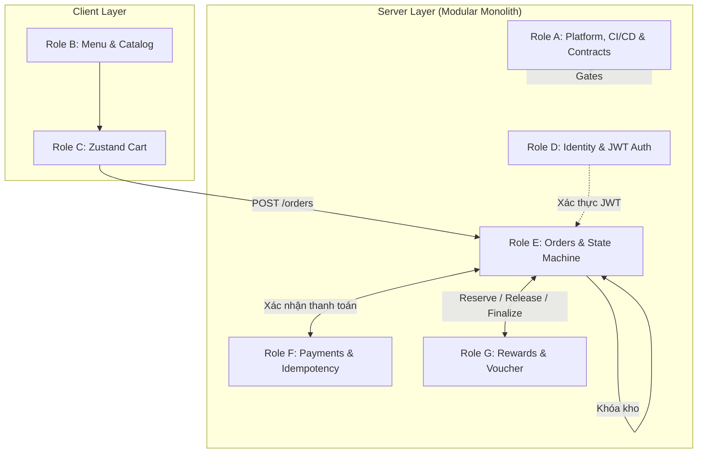
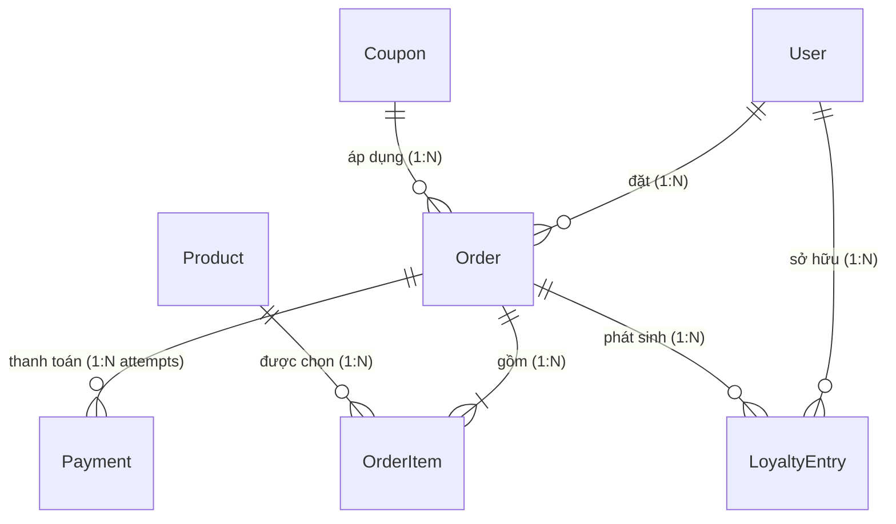

# ☕ BrewLite — Cẩm Nang Ôn Tập & Thuyết Trình Bảo Vệ (Master Guide)

> [!IMPORTANT]
> **Tài liệu chắt lọc toàn diện:** Được xây dựng trực tiếp dựa trên mã nguồn thực tế của dự án BrewLite. Dùng để ôn tập cấp tốc, nắm vững kiến trúc hệ thống và trả lời phản biện xuất sắc trước hội đồng.

---

## 📑 Mục Lục Nhanh
1. [Kể dự án trong 60 giây (Elevator Pitch)](#1-kể-dự-án-trong-60-giây-elevator-pitch)
2. [Bản đồ phân công 7 vai trò (Role A – G)](#2-bản-đồ-phân-công-7-vai-trò-role-a--g)
3. [Kiến trúc hệ thống & Đường đi của dữ liệu](#3-kiến-trúc-hệ-thống--đường-đi-của-dữ-liệu)
4. [Ví dụ xuyên suốt: Tính tiền, Kho & Điểm thưởng](#4-ví-dụ-xuyên-suốt-tính-tiền-kho--điểm-thưởng)
5. [Chi tiết 7 Module cốt lõi (Deep Dive A – G)](#5-chi-tiết-7-module-cốt-lõi-deep-dive-a--g)
6. [Mô hình CSDL & Quan hệ then chốt (ERD)](#6-mô-hình-csdl--quan-hệ-then-chốt-erd)
7. [Quy trình CI/CD & Đảm bảo chất lượng (QA)](#7-quy-trình-cicd--đảm-bảo-chất-lượng-qa)
8. [Kịch bản Demo thực chiến 4 bước](#8-kịch-bản-demo-thực-chiến-4-bước)

---

## 1. Kể Dự Án Trong 60 Giây (Elevator Pitch)

> *"BrewLite là nền tảng đặt cà phê và thanh toán không tiền mặt hiện đại. Hệ thống giải quyết 3 bài toán kỹ thuật cốt lõi trong thương mại điện tử:*
> 1. ***Server-authoritative Pricing:*** *Server toàn quyền quyết định giá, triệt tiêu nguy cơ gian lận từ client.*
> 2. ***Concurrency Stock Control:*** *Kiểm soát tồn kho đồng thời nguyên tử bằng Database Transaction & OCC, không bao giờ bán vượt kho.*
> 3. ***Strict Idempotency:*** *Bảo vệ giao dịch kép với Idempotency-Key và SHA-256 payload hash, ngăn chặn việc trừ tiền hoặc tạo đơn lặp khi mạng chập chờn.*
>
> *Dự án được tổ chức theo kiến trúc **Modular Monolith** trong một **Monorepo** với NestJS, Next.js và PostgreSQL, đảm bảo ranh giới module nghiêm ngặt và tính nhất quán dữ liệu ACID."*

---

## 2. Bản Đồ Phân Công 7 Vai Trò (Role A – G)

> [!NOTE]
> A–G là **7 vai trò phát triển phần mềm**, không phải 7 microservices độc lập.



| Role | Thành phần | Trách nhiệm chính | Điểm mấu chốt kỹ thuật |
| :---: | :--- | :--- | :--- |
| **A** | **Platform / Core** | Docker, CI/CD, Contract guard, Prisma migration, nghiệm thu | `scripts/verify-foundation.mjs` bảo vệ ranh giới import giữa các module. |
| **B** | **Catalog** | API sản phẩm, trang Menu, trang chi tiết, chọn Size/Topping | Chỉ xem trước giá (`preview`). Không tự ý trừ kho hay tạo đơn. |
| **C** | **Cart** | Quản lý giỏ hàng trên trình duyệt bằng Zustand (LocalStorage) | Khóa biến thể: `productId + size + sorted(toppings)`. Chưa trừ kho ở bước này. |
| **D** | **Identity** | Đăng ký, đăng nhập, Bcrypt (cost 12), JWT Guard | Cấp danh tính xác thực; bảo vệ endpoint bằng `@CurrentUser()`. |
| **E** | **Ordering** | Tạo đơn, tính giá server, khóa tồn kho nguyên tử, State Machine | Gom số lượng theo sản phẩm, trừ kho có điều kiện `stock >= qty`. |
| **F** | **Payments** | Thanh toán Mock/VNPay/Stripe, Idempotency-Key, Webhook replay | Tối đa 1 Payment PENDING cho mỗi đơn hàng; xác thực chữ ký Webhook. |
| **G** | **Rewards** | Voucher `GIAM10`, giữ chỗ/hoàn điểm, sổ cái Loyalty ledger | Chạy trong cùng DB transaction với Order để đảm bảo rollback toàn phần. |

---

## 3. Kiến Trúc Hệ Thống & Đường Đi Của Dữ Liệu

### 3.1 Sơ đồ kiến trúc tổng quan

```mermaid
flowchart LR
    Browser["Trình duyệt (React UI)"]
    Next["Next.js App Router (:3000)"]
    Nest["NestJS API Server (:3001)"]
    DB[("PostgreSQL 16 (:5432)")]
    Gateways["Stripe / VNPay / Mock"]

    Browser -->|Tải HTML / SSR| Next
    Browser -->|REST API + Bearer JWT| Nest
    Nest -->|Prisma ORM (ACID Tx)| DB
    Nest <-->|Tạo phiên / Webhook IPN| Gateways
```

> [!TIP]
> **Điểm ăn điểm khi trả lời:**
> - **Monorepo:** Cùng nằm chung 1 Git repository để đồng bộ tài liệu, contracts và CI/CD.
> - **Modular Monolith:** Backend chạy chung 1 tiến trình NestJS và 1 Database Postgres. Các module giao tiếp qua **Port / public.ts**, không phụ thuộc chéo vào file nội bộ của nhau.

### 3.2 Vòng đời của một HTTP Request tại Backend

```
HTTP Request 
  ➔ JwtAuthGuard (Xác minh Bearer Token)
  ➔ ValidationPipe (Kiểm tra DTO: whitelist, cấm trường lạ)
  ➔ Controller (Bóc tách parameters, gọi Service)
  ➔ Service (Điều phối nghiệp vụ & Quản lý Prisma Transaction)
  ➔ Database (PostgreSQL thực thi commit / rollback)
  ➔ Response JSON chuẩn hóa
```

---

## 4. Ví Dụ Xuyên Suốt: Tính Tiền, Kho & Điểm Thưởng

> **Tình huống thực tế:** Đồ uống gốc **45.000đ**, chọn Size M (+5.000đ), 1 Topping (+5.000đ), mua 2 ly. Khách dùng mã giảm 10%, đổi 5.000 điểm thưởng (khách đang có 8.000 điểm).

### 4.1 Bảng tính toán dòng tiền (Server-authoritative)

| Đại lượng | Công thức | Kết quả | Ghi chú |
| :--- | :--- | :---: | :--- |
| `unitPrice` | `45.000 + 5.000 + 5.000` | **55.000đ** | Đơn giá 1 ly theo size & topping |
| `lineTotal` | `55.000 × 2` | **110.000đ** | Tổng tiền dòng sản phẩm |
| `subtotal` | Tổng các lineTotal | **110.000đ** | Tổng tiền trước giảm |
| Giảm Voucher | `floor(110.000 × 10%)` | **-11.000đ** | Voucher áp dụng trước điểm thưởng |
| Điểm dùng | Đổi 5.000 điểm | **-5.000đ** | 1 điểm = 1 VNĐ |
| `discountTotal`| `11.000 + 5.000` | **16.000đ** | Tổng giảm giá (đã gồm cả điểm) |
| **`Order.total`** | `subtotal - discountTotal` | **94.000đ** | **Số tiền khách thực trả qua Payment** |
| Điểm tích lũy (`EARN`) | `floor(94.000 / 100)` | **+940 điểm** | Tích lũy 1% trên số tiền thực trả |

### 4.2 Diễn biến trạng thái tài nguyên qua các giai đoạn

| Thời điểm | Tồn kho (Stock) | Số dư điểm | Voucher `GIAM10` | Sổ cái LoyaltyEntry |
| :--- | :---: | :---: | :---: | :--- |
| **1. Bỏ vào giỏ hàng** | Không đổi | 8.000 | Không đổi | Chưa có |
| **2. Tạo đơn (`PENDING`)** | **Giảm 2 (Khóa)** | **Giảm còn 3.000 (Tạm giữ)**| Tăng usedCount | Chưa ghi REDEEM / EARN |
| **3. Thanh toán thất bại** | Vẫn giữ 2 | Vẫn giữ 3.000 | Vẫn giữ lượt | Chưa ghi nhận |
| **4a. Trả tiền thành công (`PAID`)**| Không trừ thêm | **Tăng lên 3.940** | Chốt sử dụng | **Ghi REDEEM 5.000 & EARN 940** |
| **4b. Hủy đơn (khi chưa trả)** | **Hoàn lại 2** | **Hoàn về 8.000** | Trả lại lượt | Không phát sinh thưởng |

---

## 5. Chi Tiết 7 Module Cốt Lõi (Deep Dive A – G)

### 🛒 Module B & C: Catalog & Giỏ hàng (Cart)
- **Cart lưu ở đâu?** Lưu ở **LocalStorage** bằng Zustand persist. Giỏ hàng chỉ là ý định tạm thời của khách hàng.
- **Khóa gộp món (Cart Item Key):** Ghép từ `productId + size + sorted(toppings)`. Đổi thứ tự topping không tạo dòng mới.
- **Vì sao không trừ kho khi thêm giỏ?** Nếu trừ kho ngay, khách vãng lai thêm vào giỏ rồi bỏ đi sẽ chiếm dụng kho, gây hiện tượng hết hàng ảo (denial-of-inventory).

---

### 🔐 Module D: Identity (Xác thực & Phân quyền)
- **Mật khẩu:** Băm một chiều bằng **Bcrypt** với cost factor 12. Không bao giờ lưu hay trả về mật khẩu gốc.
- **JWT:** Chứa `sub` (userId), `email`, thời hạn 1 ngày.
- **Bảo mật:** Backend dùng `JwtAuthGuard` bóc tách identity đưa vào `@CurrentUser()`. Mọi query đều lọc theo `userId` từ token, cấm client tự truyền `userId` qua body để tránh truy cập trái phép đơn của người khác.

---

### 📦 Module E: Ordering (Trung tâm điều phối & Khóa kho)
- **Idempotency Key & SHA-256 Hash:**
  ```text
  Client gửi: Idempotency-Key + Body (items, coupon, points)
    ➔ Server tính SHA-256 Hash của Body
    ➔ Khớp Key & Khớp Hash: Trả lại đơn đã tạo (Không trừ kho lần 2)
    ➔ Khớp Key nhưng Khác Hash: Ném lỗi 409 Conflict (Gian lận / Sửa payload)
  ```
- **Chống bán vượt kho (Concurrency Control):**
  Thực hiện cập nhật có điều kiện ngay trong SQL:
  ```sql
  UPDATE "Product"
  SET stock = stock - :qty, version = version + 1
  WHERE id = :id AND stock >= :qty;
  ```
  Nếu số dòng cập nhật = 0 ➔ Hết hàng ➔ Tự động Rollback transaction và trả lỗi `409 Conflict (OUT_OF_STOCK)`.

- **Máy trạng thái đơn hàng (Order State Machine):**
  ```mermaid
  stateDiagram-v2
    [*] --> PENDING: Khách tạo đơn
    PENDING --> PAID: Webhook xác nhận trả tiền
    PENDING --> PAYMENT_FAILED: Cổng từ chối
    PAYMENT_FAILED --> PENDING: Khách thử thanh toán lại
    PENDING --> CANCELLED: Khách hủy / Hết hạn 30p
    PAYMENT_FAILED --> CANCELLED: Khách hủy / Hết hạn
    PAID --> PREPARING: Quản trị viên bấm làm món
    PREPARING --> READY: Đồ uống sẵn sàng
    READY --> COMPLETED: Đã nhận đồ uống
  ```

---

### 💳 Module F: Payments (Thanh toán & Chống lặp)
- **Phân biệt 2 loại Key:**
  - *Order Key:* Nhận diện ý định tạo giỏ hàng này thành 1 đơn hàng duy nhất.
  - *Payment Key:* Nhận diện 1 lần thử quẹt thẻ/quét QR cho đơn hàng đó.
- **Quy tắc an toàn:** Mỗi đơn hàng tại 1 thời điểm chỉ cho phép **tối đa 1 Payment ở trạng thái `PENDING`** (được khóa bằng Partial Unique Index trong Postgres).
- **Webhook Security:** Webhook của Stripe và IPN của VNPay bắt buộc phải được **xác minh chữ ký số** (HMAC-SHA512 với VNPay / Signature Secret với Stripe) trước khi cập nhật đơn hàng thành `PAID`.

---

### 🎁 Module G: Rewards (Ưu đãi & Điểm thưởng)
- **Nguyên tắc chia tầng:** Tách biệt hàm tính toán thuần túy (`pure functions` trong `reward-rules.ts`) khỏi phần lưu trữ CSDL (`rewards.service.ts`), giúp việc viết Unit Test cực nhanh và chính xác.
- **Sổ cái điểm thưởng (LoyaltyEntry):**
  Mỗi giao dịch điểm gắn chặt với cặp duy nhất `(orderId, kind)`:
  - `REDEEM`: Chốt trừ số điểm khách dùng mua đơn.
  - `EARN`: Cộng điểm thưởng sau khi đơn đã `PAID`.
  - `REFUND`: Thu hồi điểm nếu đơn hàng bị hoàn tiền.

---

## 6. Mô Hình CSDL & Quan Hệ Then Chốt (ERD)



> [!IMPORTANT]
> **Điểm nhấn thiết kế CSDL:**
> - **Snapshot giá:** Bảng `OrderItem` lưu cứng `unitPrice` và `lineTotal` tại thời điểm đặt. Sau này chủ quán đổi giá `Product`, lịch sử đơn cũ không bị thay đổi.
> - **Order : Payment = 1 : N:** Thiết kế cho phép khách thanh toán thất bại lần 1 (`PAYMENT_FAILED`) có thể thử lại lần 2 trên cùng 1 đơn mà không cần tạo đơn mới.

---

## 7. Quy Trình CI/CD & Đảm Bảo Chất Lượng (QA)

Pipeline GitHub Actions [`.github/workflows/foundation.yml`](file:///c:/Users/Gtvkun/Documents/GitHub/brewlite/.github/workflows/foundation.yml) gồm 4 chốt chặn nghiêm ngặt (**Release Gates**):

```
Gate 1: Contract Guard 
  ➔ Chạy scripts/verify-foundation.mjs kiểm tra enum, giá và ranh giới import giữa các module.
Gate 2: Backend Pipeline 
  ➔ Khởi tạo PostgreSQL 16 container, Prisma migrate, Seed x2 (kiểm tra tính idempotent), Oxlint, 197 Unit Tests, E2E Tests.
Gate 3: Frontend Pipeline 
  ➔ ESLint, Next.js Build, Playwright Tests.
Gate 4: Docker Smoke Test 
  ➔ Khởi động hệ thống qua docker compose, kiểm tra HTTP Healthcheck của Backend (:3001) và Frontend (:3000).
```

---

## 8. Kịch Bản Demo Thực Chiến 4 Bước

Để bài demo trước hội đồng trơn tru và ấn tượng nhất:

1. **Bước 1: Menu & Tính giá động (Module B + C)**
   - Chọn 1 ly Cà phê muối (45k).
   - Chọn Size L (+10k), thêm Trân châu (+5k) và Kem cheese (+5k) ➔ Giá nhảy thành 65k.
   - *Nói:* "Frontend và Backend dùng chung một bộ quy tắc tính giá để tránh sai lệch."
2. **Bước 2: Giỏ hàng, Voucher & Tạo đơn (Module E + G)**
   - Vào Giỏ hàng ➔ Nhấn Đặt hàng ➔ Đăng nhập.
   - Nhập mã `GIAM10` (giảm 10%), nhập 5.000 điểm tích lũy.
   - *Nói:* "Lúc này hệ thống tạo đơn PENDING, khóa tồn kho và tạm giữ quota voucher trong một Transaction nguyên tử duy nhất."
3. **Bước 3: Thanh toán & Idempotency (Module F)**
   - Chọn cổng Mock Payment hoặc VNPay Sandbox ➔ Bấm Thanh toán.
   - *Nói:* "Giao thức thanh toán sử dụng Idempotency Key kèm chữ ký số Webhook để chống gian lận và chống trừ tiền 2 lần."
4. **Bước 4: Quản trị & Máy trạng thái (Admin Console)**
   - Mở tab `http://localhost:3000/admin`.
   - Xem đơn hàng vừa tạo ở trạng thái `PAID`.
   - Bấm nút chuyển trạng thái sang `PREPARING` ➔ `READY` ➔ `COMPLETED`.
   - *Nói:* "Quy trình pha chế được quản lý chặt chẽ theo State Machine một chiều."
