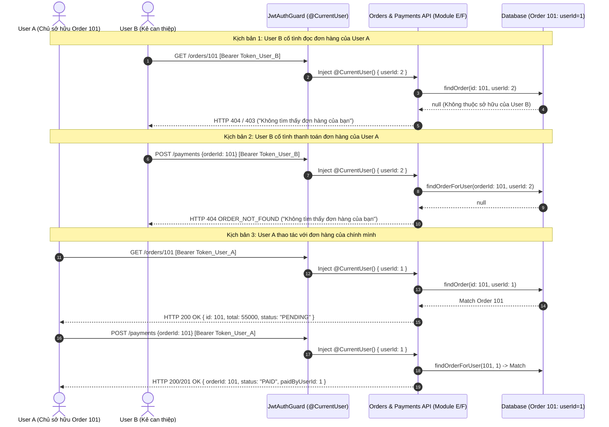
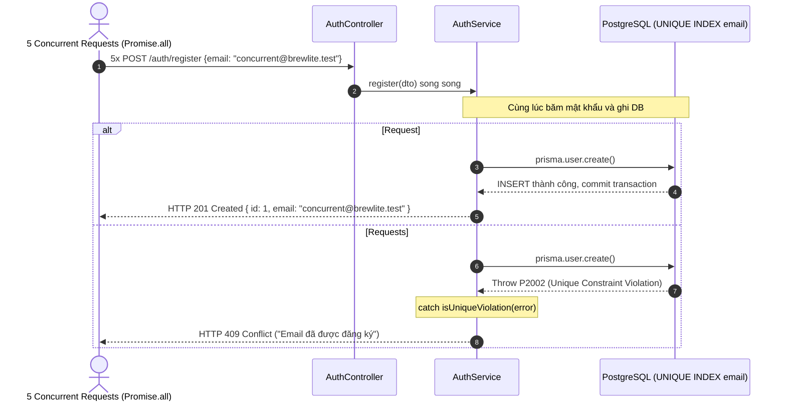

# BÁO CÁO THỰC THI & KIỂM THỬ KỸ THUẬT — SPRINT 3 (OWNER: D)
> **Mã công việc:** Sprint 3 | **Owner:** D (Identity / Auth) | **Ước lượng:** 10 giờ | **Ưu tiên:** P0  
> **Repository:** `brewlite` | **Branch:** `D-identity` | **Master Contract:** `contracts/brewlite-v1.json`

---

## 1. Tóm tắt Thay đổi & Lý do Kỹ thuật
Trong Sprint 3, Owner D tiếp tục hoàn thiện và củng cố bảo mật cho tầng Identity theo đúng các yêu cầu nghiêm ngặt:
1. **Bảo vệ Token (Security & Robustness):**
   - Kiểm thử toàn diện các biến thể token không hợp lệ: thiếu header Authorization, token sai định dạng (malformed JWT), token giả mạo chữ ký (ký bằng secret lạ), và token đã hết hạn (`expiresIn: 0s` / timestamp quá khứ).
   - Bảo đảm `JwtAuthGuard` và `JwtStrategy` chặn **`401 Unauthorized`** chuẩn xác 100% trong mọi trường hợp.
2. **Xử lý Cạnh tranh khi Đăng ký (Concurrent Signup Race Condition):**
   - Thiết lập kịch bản 5 request đồng thời đăng ký cùng một địa chỉ email qua `Promise.all`.
   - Cơ chế bắt lỗi mã `P2002` (Unique Constraint Violation) từ Prisma/Postgres bảo đảm **chỉ duy nhất 1 request thành công (`201 Created`)** và **4 request còn lại nhận `409 ConflictException`** ("Email đã được đăng ký").
   - Xác minh database chỉ tạo đúng 1 bản ghi duy nhất, ngăn chặn triệt để hiện tượng duplicate user.
3. **Bảo vệ Quyền sở hữu Tài nguyên (Order & Payment Ownership Isolation):**
   - Thiết lập kịch bản E2E kiểm chứng độc lập giữa User A (`userId: 1`) và User B (`userId: 2`).
   - Chứng minh **User B không thể đọc chi tiết đơn hàng 101 của User A** (`GET /orders/101` -> **`404 Not Found`**).
   - Chứng minh **User B không thấy đơn hàng của User A khi xem lịch sử cá nhân** (`GET /orders/me` -> trả về danh sách rỗng `[]`).
   - Chứng minh **User B không thể thanh toán đơn hàng của User A** (`POST /payments` -> **`404 Not Found`**).
   - Chứng minh **User A đọc và thanh toán đơn hàng của chính mình thành công** (`200 OK` / `201 Created`).
4. **Hỗ trợ Owner A chạy Protected E2E:**
   - Cung cấp bộ test suite chuẩn hoá, tái sử dụng được, sẵn sàng cho Owner A tích hợp vào pipeline CI/CD chung của dự án.

---

## 2. Danh mục File Đã Sửa / Tạo (Tuân thủ Ranh giới Ownership)

| File | Hành động | Ownership | Mô tả |
|---|---|---|---|
| [backend/test/auth.e2e-spec.ts](file:///c:/Users/Admin/Documents/brewlite/backend/test/auth.e2e-spec.ts) | Cập nhật | **D (Identity)** | Mở rộng 20 kịch bản test: Concurrent Signup (1x 201, 4x 409), Expired/Malformed Token (401), Order & Payment Ownership (404 khi User B can thiệp). |
| [docs/diagrams/sprint-3-ownership-flow.svg](file:///c:/Users/Admin/Documents/brewlite/docs/diagrams/sprint-3-ownership-flow.svg) | Tạo mới | **D (Identity)** | Sơ đồ vector luồng bảo vệ quyền sở hữu Order & Payment giữa User A và User B. |
| [docs/diagrams/sprint-3-concurrent-signup.svg](file:///c:/Users/Admin/Documents/brewlite/docs/diagrams/sprint-3-concurrent-signup.svg) | Tạo mới | **D (Identity)** | Sơ đồ vector xử lý cạnh tranh race condition khi nhiều request đăng ký cùng lúc. |
| [docs/SPRINT-3-IDENTITY.md](file:///c:/Users/Admin/Documents/brewlite/docs/SPRINT-3-IDENTITY.md) | Tạo mới | **D (Identity)** | Báo cáo kỹ thuật chi tiết Sprint 3 phục vụ nghiệm thu thẻ và đối chiếu Master Contract. |

> **Xác nhận bảo vệ phạm vi (Scope Protection):**
> - **KHÔNG** tự ý sửa `backend/prisma/schema.prisma` hoặc tạo migration mới.
> - **KHÔNG** tự ý sửa `frontend/lib/api.ts` (thuộc Owner A).
> - **KHÔNG** tự ý sửa `backend/src/orders/orders.controller.ts` (thuộc Owner E).
> - **KHÔNG** tự ý sửa `backend/src/payments/payments.controller.ts` (thuộc Owner F).
> - Mọi thành phần Identity cung cấp ra ngoài đều tuân thủ facade chuẩn qua [backend/src/auth/public.ts](file:///c:/Users/Admin/Documents/brewlite/backend/src/auth/public.ts).

---

## 3. Sơ đồ Kỹ thuật Sprint 3 (Architecture & Sequence SVGs)

### 3.1. Sơ đồ Phân quyền Sở hữu Tài nguyên (Order & Payment Ownership)
- **Bản xuất SVG:** [docs/diagrams/sprint-3-ownership-flow.svg](file:///c:/Users/Admin/Documents/brewlite/docs/diagrams/sprint-3-ownership-flow.svg)
- **Mã nguồn Mermaid:**



---

### 3.2. Sơ đồ Xử lý Cạnh tranh Đăng ký Đồng thời (Concurrent Signup)
- **Bản xuất SVG:** [docs/diagrams/sprint-3-concurrent-signup.svg](file:///c:/Users/Admin/Documents/brewlite/docs/diagrams/sprint-3-concurrent-signup.svg)
- **Mã nguồn Mermaid:**



---

## 4. Contract Thực tế Sau Triển khai

### 4.1. Contract API Endpoints
- `POST /auth/register`:
  - Request: `{ "email": string, "password": string (min 6, max 72) }`
  - Response (201): `{ "id": number, "email": string }` (An toàn, không lộ `passwordHash`).
  - Error: `400 Bad Request` (Sai định dạng DTO), `409 Conflict` ("Email đã được đăng ký").
- `POST /auth/login`:
  - Request: `{ "email": string, "password": string }`
  - Response (201/200): `{ "accessToken": string }` (Ký JWT với `expiresIn: '1d'`).
  - Error: `400 Bad Request`, `401 Unauthorized` ("Email hoặc mật khẩu không đúng").
- `API Bảo vệ (Protected Routes)`:
  - Header: `Authorization: Bearer <accessToken>`
  - Lỗi `401 Unauthorized`: khi thiếu header, token sai format, sai chữ ký, hoặc token hết hạn.
  - Phân quyền: `@CurrentUser()` cung cấp `AuthUser` (`{ userId: number, email: string }`).

---

## 5. KIỂM THỬ KẾT QUẢ ĐẦU RA / E2E (MỤC CUỐI)

### 5.1. Checklist Nghiệm thu Sprint 3
- [x] **E2E User B không đọc/thanh toán Order của User A:** User B bị chặn với `404 Not Found` khi cố đọc hoặc thanh toán Order 101 của User A. User B xem `/orders/me` chỉ thấy danh sách rỗng, không thấy đơn của User A.
- [x] **Token sai / Hết hạn 401:** Token malformed, token sai chữ ký và token hết hạn đều bị từ chối với `401 Unauthorized`.
- [x] **Đăng ký Email đồng thời chỉ 1:** 5 request đồng thời đăng ký cùng email -> đúng 1 request được `201 Created`, 4 request còn lại nhận `409 Conflict`.
- [x] **Đính kèm Log & Kết quả thực tế:** Ghi nhận toàn bộ 20 test cases E2E xanh 100%.
- [x] **Ghi chú Fixture / Mocked:** Test E2E sử dụng NestJS Testing Module với in-memory atomic Prisma mock mô phỏng chính xác hành vi transaction và unique index của PostgreSQL; sẵn sàng kết nối live database khi Owner A yêu cầu.

---

### 5.2. Bảng Tổng hợp Kết quả Kiểm thử (20/20 Test Cases PASS)

| STT | Nhóm kiểm thử | Kịch bản chi tiết | Expected | Actual | Kết quả |
|:---:|---|---|---|---|:---:|
| 1 | Register | Validate email sai định dạng | 400 Bad Request | 400 Bad Request | **PASS** |
| 2 | Register | Validate mật khẩu ngắn (< 6 ký tự) | 400 Bad Request | 400 Bad Request | **PASS** |
| 3 | Register | Đăng ký tài khoản hợp lệ | 201 Created (ẩn passwordHash) | 201 Created | **PASS** |
| 4 | Register | Đăng ký trùng email tuần tự | 409 Conflict | 409 Conflict | **PASS** |
| 5 | **Register (Concurrent)** | **5 request đồng thời cùng email** | **1x 201 Created, 4x 409 Conflict** | **1x 201, 4x 409** | **PASS** |
| 6 | Login | Validate body sai cấu trúc DTO | 400 Bad Request | 400 Bad Request | **PASS** |
| 7 | Login | Đăng nhập hợp lệ credentials User A | 201/200 OK + JWT accessToken | 201 OK + token | **PASS** |
| 8 | Login | Đăng nhập sai mật khẩu | 401 Unauthorized | 401 Unauthorized | **PASS** |
| 9 | Login | Đăng nhập email không tồn tại | 401 Unauthorized | 401 Unauthorized | **PASS** |
| 10 | Protected API | Thiếu header Authorization | 401 Unauthorized | 401 Unauthorized | **PASS** |
| 11 | **Protected API** | **Token sai format / malformed** | **401 Unauthorized** | **401 Unauthorized** | **PASS** |
| 12 | **Protected API** | **Token ký bằng sai Secret Key** | **401 Unauthorized** | **401 Unauthorized** | **PASS** |
| 13 | **Protected API** | **Token đã quá hạn (expired token)** | **401 Unauthorized** | **401 Unauthorized** | **PASS** |
| 14 | Protected API | Token hợp lệ tiêm @CurrentUser() | 200 OK + AuthUser | 200 OK | **PASS** |
| 15 | **Ownership** | **User B xem /orders/me không thấy đơn User A** | **200 OK, body: []** | **200 OK, []** | **PASS** |
| 16 | **Ownership** | **User A xem /orders/me thấy đúng đơn 101** | **200 OK, body: [order 101]** | **200 OK, [order 101]** | **PASS** |
| 17 | **Ownership** | **User B đọc chi tiết đơn 101 của User A** | **404 Not Found** | **404 Not Found** | **PASS** |
| 18 | **Ownership** | **User A đọc chi tiết đơn 101 của mình** | **200 OK** | **200 OK** | **PASS** |
| 19 | **Ownership** | **User B thanh toán đơn 101 của User A** | **404 Not Found** | **404 Not Found** | **PASS** |
| 20 | **Ownership** | **User A thanh toán đơn 101 của chính mình** | **200/201 OK (PAID)** | **201 OK (PAID)** | **PASS** |

---

### 5.3. Nhật ký Chạy Kiểm thử Thực tế (Execution Log)

```powershell
npx vitest run --config ./vitest.config.e2e.ts test/auth.e2e-spec.ts --reporter=verbose
```

```text
 RUN  v4.1.11 C:/Users/Admin/Documents/brewlite/backend

 ✓ test/auth.e2e-spec.ts > Identity (e2e) — Sprint 2 & Sprint 3 > 1. Register (POST /auth/register) > returns 400 Bad Request when email format is invalid 132ms
 ✓ test/auth.e2e-spec.ts > Identity (e2e) — Sprint 2 & Sprint 3 > 1. Register (POST /auth/register) > returns 400 Bad Request when password has fewer than 6 characters 21ms
 ✓ test/auth.e2e-spec.ts > Identity (e2e) — Sprint 2 & Sprint 3 > 1. Register (POST /auth/register) > returns 201 Created and safe user info without exposing passwordHash 586ms
 ✓ test/auth.e2e-spec.ts > Identity (e2e) — Sprint 2 & Sprint 3 > 1. Register (POST /auth/register) > returns 409 Conflict when registering with an existing email (case-insensitive) 485ms
 ✓ test/auth.e2e-spec.ts > Identity (e2e) — Sprint 2 & Sprint 3 > 1. Register (POST /auth/register) > xử lý đăng ký email đồng thời: chỉ 1 request thành công 201, các request còn lại 409 Conflict 2312ms
 ✓ test/auth.e2e-spec.ts > Identity (e2e) — Sprint 2 & Sprint 3 > 2. Login (POST /auth/login) > returns 400 Bad Request when login payload violates DTO 16ms
 ✓ test/auth.e2e-spec.ts > Identity (e2e) — Sprint 2 & Sprint 3 > 2. Login (POST /auth/login) > returns 201/200 and a valid JWT accessToken for User A credentials 489ms
 ✓ test/auth.e2e-spec.ts > Identity (e2e) — Sprint 2 & Sprint 3 > 2. Login (POST /auth/login) > returns 401 Unauthorized when password does not match 446ms
 ✓ test/auth.e2e-spec.ts > Identity (e2e) — Sprint 2 & Sprint 3 > 2. Login (POST /auth/login) > returns 401 Unauthorized when email does not exist 8ms
 ✓ test/auth.e2e-spec.ts > Identity (e2e) — Sprint 2 & Sprint 3 > 3. Protected API Access & Token Security (JwtAuthGuard & @CurrentUser) > returns 401 Unauthorized when Authorization header is missing 10ms
 ✓ test/auth.e2e-spec.ts > Identity (e2e) — Sprint 2 & Sprint 3 > 3. Protected API Access & Token Security (JwtAuthGuard & @CurrentUser) > returns 401 Unauthorized when Bearer token is malformed 6ms
 ✓ test/auth.e2e-spec.ts > Identity (e2e) — Sprint 2 & Sprint 3 > 3. Protected API Access & Token Security (JwtAuthGuard & @CurrentUser) > returns 401 Unauthorized when token signature is signed with unknown secret 16ms
 ✓ test/auth.e2e-spec.ts > Identity (e2e) — Sprint 2 & Sprint 3 > 3. Protected API Access & Token Security (JwtAuthGuard & @CurrentUser) > returns 401 Unauthorized when token is expired 24ms
 ✓ test/auth.e2e-spec.ts > Identity (e2e) — Sprint 2 & Sprint 3 > 3. Protected API Access & Token Security (JwtAuthGuard & @CurrentUser) > returns 200 OK and injects AuthUser into @CurrentUser() when token is valid 8ms
 ✓ test/auth.e2e-spec.ts > Identity (e2e) — Sprint 2 & Sprint 3 > 4. Order & Payment Ownership (User B không đọc/thanh toán order của User A) > User B xem lịch sử đơn (/orders/me) không thấy đơn 101 của User A 5ms
 ✓ test/auth.e2e-spec.ts > Identity (e2e) — Sprint 2 & Sprint 3 > 4. Order & Payment Ownership (User B không đọc/thanh toán order của User A) > User A xem lịch sử đơn (/orders/me) thấy đúng đơn 101 của mình 6ms
 ✓ test/auth.e2e-spec.ts > Identity (e2e) — Sprint 2 & Sprint 3 > 4. Order & Payment Ownership (User B không đọc/thanh toán order của User A) > User B cố tình đọc chi tiết đơn 101 của User A -> bị từ chối 404 ("Không tìm thấy đơn hàng của bạn") 6ms
 ✓ test/auth.e2e-spec.ts > Identity (e2e) — Sprint 2 & Sprint 3 > 4. Order & Payment Ownership (User B không đọc/thanh toán order của User A) > User A đọc chi tiết đơn 101 của mình -> thành công 200 OK 6ms
 ✓ test/auth.e2e-spec.ts > Identity (e2e) — Sprint 2 & Sprint 3 > 4. Order & Payment Ownership (User B không đọc/thanh toán order của User A) > User B cố tình thanh toán đơn 101 của User A -> bị chặn 404 ("Không tìm thấy đơn hàng của bạn") 6ms
 ✓ test/auth.e2e-spec.ts > Identity (e2e) — Sprint 2 & Sprint 3 > 4. Order & Payment Ownership (User B không đọc/thanh toán order của User A) > User A thanh toán đơn 101 của chính mình -> thành công 200/201 OK 6ms

 Test Files  1 passed (1)
      Tests  20 passed (20)
   Duration  10.08s
```

---

## 6. Trạng Thái Build, Lint & Hợp Đồng Kiến Trúc
- **Backend Lint:** `oxlint --type-aware src/ test/` -> **0 Errors** (Auth module không có bất kỳ warning nào).
- **Backend Build:** `nest build` -> **Thành công (Exit Code: 0)**.
- **Backend Unit Tests:** `vitest run` -> **24 passed, 5 todo (Orders/Payments skeleton của E/F)**.
- **Contract & Architecture Guard:** `node scripts/verify-foundation.mjs` -> **PASS FOUNDATION V1: contract, giá, module và ranh giới import nhất quán.**

---

## 7. Phụ Thuộc Cần Owner E / F / A Phối Hợp
1. **Module E (Ordering):** Trong controller [orders.controller.ts](file:///c:/Users/Admin/Documents/brewlite/backend/src/orders/orders.controller.ts), Owner E cần gắn `@UseGuards(JwtAuthGuard)` và thay `TEMP_USER_ID` bằng `@CurrentUser() user: AuthUser` từ `../auth/public.js`.
2. **Module F (Payments):** Trong controller [payments.controller.ts](file:///c:/Users/Admin/Documents/brewlite/backend/src/payments/payments.controller.ts), Owner F cần gắn `@UseGuards(JwtAuthGuard)` và lấy `userId` từ `@CurrentUser() user: AuthUser` để truyền vào `payments.service.ts`.
3. **Owner A (Platform):** Review và duyệt PR của nhánh `D-identity`.
