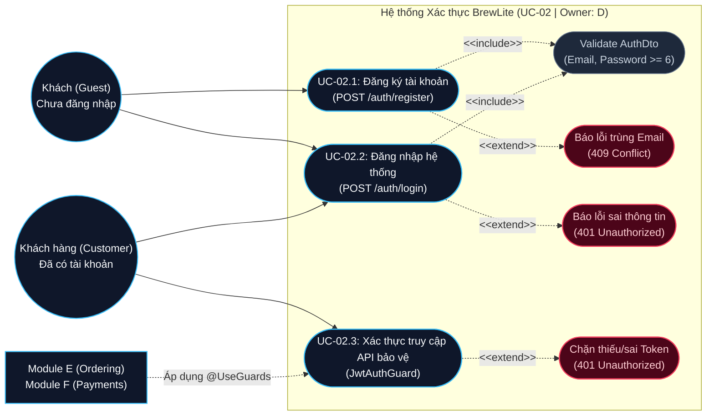
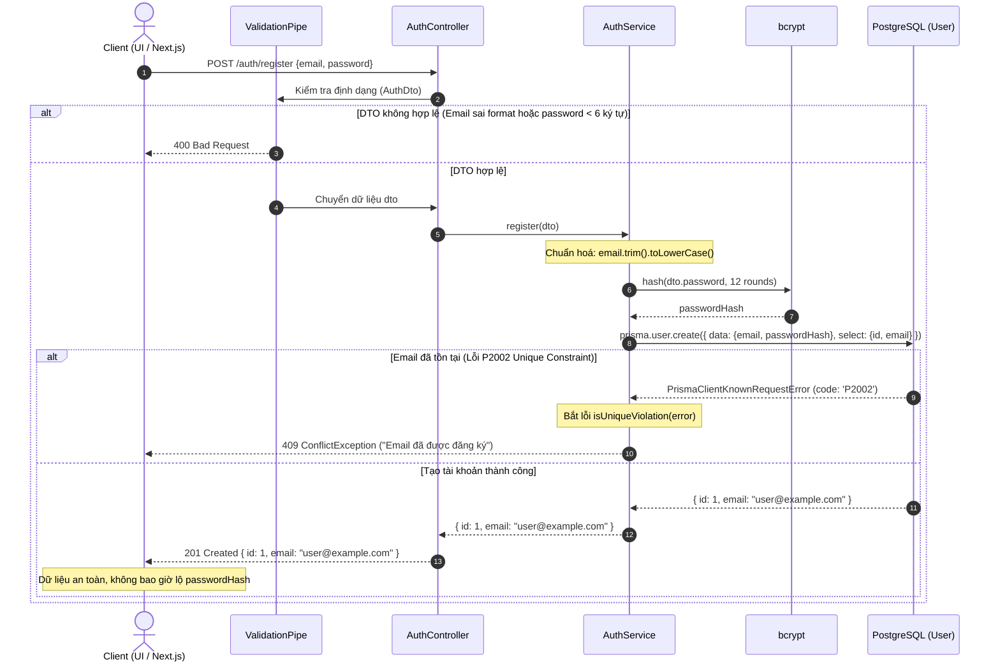
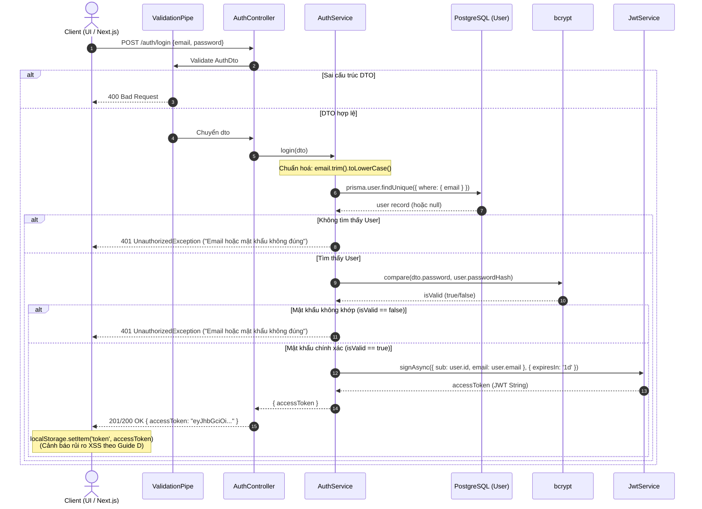
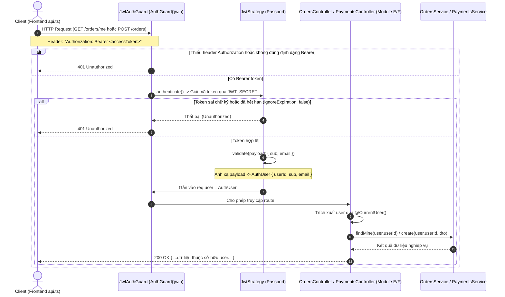

# TÀI LIỆU SƠ ĐỒ & ĐẶC TẢ KỸ THUẬT — UC-02: IDENTITY & AUTHENTICATION
> **Owner:** D (Identity) | **Ước lượng:** 2 giờ | **Hạn:** 2026-10-24 23:59 (GMT+7) | **Sprint:** S2  
> **Repository:** `brewlite` | **Branch:** `D-identity` | **Master Contract:** `contracts/brewlite-v1.json` v1.0.0

---

## 1. Mục tiêu & Phạm vi (Scope)
Tài liệu và mã nguồn này triển khai phần nền tảng xác thực người dùng (**UC-02**) thuộc trách nhiệm của **Owner D**, bảo đảm:
1. **Đăng ký tài khoản (Register):** `POST /auth/register` tiếp nhận `email`, `password`. Chuẩn hoá email (trim/lowercase), băm mật khẩu bằng `bcrypt` (12 rounds), chặn trùng email trả về `409 Conflict`, lưu DB và trả về `201 Created` kèm thông tin an toàn (tuyệt đối không lộ `passwordHash`).
2. **Đăng nhập (Login):** `POST /auth/login` kiểm tra định dạng qua `AuthDto`, tìm kiếm tài khoản, đối chiếu mật khẩu băm, xử lý lỗi thông tin sai trả về `401 Unauthorized`, cấp phát token JWT ký bằng `JWT_SECRET` với payload `{ sub: userId, email }`.
3. **Quy tắc Refresh Token:** **Tuyệt đối không đưa refresh token bắt buộc** vào hệ thống khi chưa có quyết định nhóm và PO duyệt (tuân thủ nguyên tắc hợp đồng Master Contract V1).
4. **Bảo vệ API cần đăng nhập (Protected Routes):** Cung cấp `JwtAuthGuard` và Decorator `@CurrentUser()` qua ranh giới công khai `backend/src/auth/public.ts`. Chặn `401 Unauthorized` khi thiếu token hoặc token không hợp lệ / hết hạn. Trích xuất chính xác `AuthUser` cho các module **E (Ordering)** và **F (Payments)** sử dụng.
5. **Giao diện Client (Frontend):** Trang `frontend/app/login/page.tsx` hỗ trợ chuyển đổi linh hoạt Đăng nhập / Đăng ký, lưu trữ JWT vào `localStorage` theo đề bài kèm ghi chú cảnh báo rủi ro bảo mật XSS.

---

## 2. Căn cứ Kỹ thuật & Người Review

| Bên liên quan | Vai trò | Trách nhiệm phối hợp & Review |
|---|---|---|
| **D (Identity)** | **Owner** | Sở hữu toàn bộ `backend/src/auth/*`, `frontend/app/login/*`, unit test và E2E test cho Auth. |
| **A (Platform / Integration)** | Reviewer | Review access contract, bảo đảm module D tuân thủ ranh giới import (chỉ xuất qua `public.ts`), kiểm tra script `scripts/verify-foundation.mjs` PASS. |
| **E (Ordering)** | Consumer | Tiêu thụ `JwtAuthGuard` và `@CurrentUser()` từ `../auth/public.js` để bảo vệ `POST /orders` và `GET /orders/me`. |
| **F (Payments)** | Consumer | Tiêu thụ `JwtAuthGuard` và `@CurrentUser()` từ `../auth/public.js` để bảo vệ `POST /payments`. |

---

## 3. Nghiệm thu Sơ đồ (Diagram Acceptance Checklist)

- [x] **Có file nguồn chỉnh sửa được:** Cung cấp đầy đủ mã nguồn Mermaid trong tài liệu này (có thể mở và chỉnh sửa trực tiếp trên GitHub/VS Code/Mermaid Live Editor) và các bản xuất vector SVG trực quan tại `docs/diagrams/`.
- [x] **Khớp Master Contract + Repo thực tế:** Mọi tên Actor (`Guest`, `Customer`), Class (`AuthController`, `AuthService`, `JwtStrategy`, `JwtAuthGuard`), Entity (`User`), DTO (`AuthDto`), API endpoint (`/auth/register`, `/auth/login`), mã lỗi (`400`, `401`, `409`, `201`, `200`) đều ánh xạ 1-1 với code thực tế trong repo; không bịa đặt chức năng.
- [x] **Ranh giới Module & Review đa bên:** Sơ đồ thể hiện rõ đường ranh giới module của D và điểm giao thoa với A, E, F thông qua facade `public.ts`.

---

## 4. Danh mục Thành phần Hệ thống Thực tế

### 4.1. Bảng ánh xạ API Endpoints
| Phương thức | Đường dẫn API | Xác thực (Auth) | Body đầu vào | Response thành công | Mã lỗi nghiệp vụ |
|---|---|---|---|---|---|
| `POST` | `/auth/register` | Không | `{ email, password }` | `201 Created`: `{ id, email }` | `400` (Sai DTO), `409` (Trùng email) |
| `POST` | `/auth/login` | Không | `{ email, password }` | `201/200 OK`: `{ accessToken }` | `400` (Sai DTO), `401` (Sai thông tin) |
| `GET` / `POST` | `/orders`, `/orders/me`, `/payments` | `Bearer JWT` | Theo từng nghiệp vụ | Theo từng nghiệp vụ | `401` (Thiếu / sai / hết hạn token) |

### 4.2. Bảng ánh xạ Class & Entity
| Thành phần | Đường dẫn file thực tế | Trách nhiệm |
|---|---|---|
| `AuthController` | [auth.controller.ts](file:///c:/Users/Admin/Documents/brewlite/backend/src/auth/auth.controller.ts) | Tiếp nhận HTTP request cho register/login, điều phối sang `AuthService`. |
| `AuthService` | [auth.service.ts](file:///c:/Users/Admin/Documents/brewlite/backend/src/auth/auth.service.ts) | Xử lý logic băm mật khẩu (bcrypt 12 rounds), kiểm tra lỗi trùng DB P2002, so sánh mật khẩu, ký JWT. |
| `AuthDto` | [auth.dto.ts](file:///c:/Users/Admin/Documents/brewlite/backend/src/auth/auth.dto.ts) | Validate `email` (chuẩn email, tối đa 254 ký tự), `password` (tối thiểu 6, tối đa 72 ký tự). |
| `JwtStrategy` | [jwt.strategy.ts](file:///c:/Users/Admin/Documents/brewlite/backend/src/auth/jwt.strategy.ts) | Passport strategy giải mã Bearer JWT từ request header, thẩm định với `JWT_SECRET`, trả về `AuthUser`. |
| `JwtAuthGuard` | [jwt-auth.guard.ts](file:///c:/Users/Admin/Documents/brewlite/backend/src/auth/jwt-auth.guard.ts) | Kế thừa `AuthGuard('jwt')`, bảo vệ route, chặn 401 khi không đạt yêu cầu xác thực. |
| `@CurrentUser()` | [current-user.decorator.ts](file:///c:/Users/Admin/Documents/brewlite/backend/src/auth/current-user.decorator.ts) | Custom param decorator trích xuất đối tượng `AuthUser` từ `req.user`. |
| `public.ts` | [public.ts](file:///c:/Users/Admin/Documents/brewlite/backend/src/auth/public.ts) | Điểm công khai duy nhất cho các module khác import (`JwtAuthGuard`, `CurrentUser`, `AuthUser`). |
| `User` | [schema.prisma](file:///c:/Users/Admin/Documents/brewlite/backend/prisma/schema.prisma) | Bảng dữ liệu người dùng: `id`, `email` (unique index), `passwordHash`, `createdAt`, `updatedAt`. |

---

## 5. Các Sơ đồ Kiến trúc & Tuần tự (Diagrams)

### 5.1. Sơ đồ Use Case Hệ thống (Use Case Diagram)
- **Bản xuất SVG:** [docs/diagrams/uc-02-use-case.svg](file:///c:/Users/Admin/Documents/brewlite/docs/diagrams/uc-02-use-case.svg)
- **Mã nguồn Mermaid:**



---

### 5.2. Sơ đồ Tuần tự: UC-02.1 Đăng ký tài khoản (Register)
- **Bản xuất SVG:** [docs/diagrams/uc-02-sequence-register.svg](file:///c:/Users/Admin/Documents/brewlite/docs/diagrams/uc-02-sequence-register.svg)
- **Mã nguồn Mermaid:**



---

### 5.3. Sơ đồ Tuần tự: UC-02.2 Đăng nhập & Cấp phát JWT (Login)
- **Bản xuất SVG:** [docs/diagrams/uc-02-sequence-login.svg](file:///c:/Users/Admin/Documents/brewlite/docs/diagrams/uc-02-sequence-login.svg)
- **Mã nguồn Mermaid:**



---

### 5.4. Sơ đồ Tuần tự: UC-02.3 Xác thực Truy cập API Bảo vệ (Protected Route)
- **Bản xuất SVG:** [docs/diagrams/uc-02-sequence-protected-access.svg](file:///c:/Users/Admin/Documents/brewlite/docs/diagrams/uc-02-sequence-protected-access.svg)
- **Mã nguồn Mermaid:**



---

### 5.5. Sơ đồ Class & Ranh giới Module (Architecture & Boundaries)
- **Bản xuất SVG:** [docs/diagrams/uc-02-class-architecture.svg](file:///c:/Users/Admin/Documents/brewlite/docs/diagrams/uc-02-class-architecture.svg)
- **Mã nguồn Mermaid:**

```mermaid
classDiagram
  direction TB

  namespace Module_D_Auth_Internal {
    class AuthModule {
      +imports: [PassportModule, JwtModule]
      +controllers: [AuthController]
      +providers: [AuthService, JwtStrategy]
      +exports: [AuthService]
    }

    class AuthController {
      -auth: AuthService
      +register(dto: AuthDto) Promise
      +login(dto: AuthDto) Promise
    }

    class AuthService {
      -prisma: PrismaService
      -jwt: JwtService
      -PASSWORD_ROUNDS: 12
      +register(dto: AuthDto) Promise<{id, email}>
      +login(dto: AuthDto) Promise<{accessToken}>
    }

    class AuthDto {
      +email: string
      +password: string
    }

    class JwtStrategy {
      +getJwtSecret() string
      +validate(payload: JwtPayload) AuthUser
    }
  }

  namespace Module_D_Public_Contract {
    class PublicApi {
      <<Facade backend/src/auth/public.ts>>
      +JwtAuthGuard
      +CurrentUser()
      +type AuthUser
    }

    class JwtAuthGuard {
      +canActivate(context) boolean
    }

    class AuthUser {
      +userId: number
      +email: string
    }
  }

  namespace External_Consumers_And_DB {
    class UserEntity {
      <<Prisma DB Table: "User">>
      +id: Int (PK)
      +email: String (Unique)
      +passwordHash: String
      +createdAt: DateTime
      +updatedAt: DateTime
    }

    class OrdersController {
      <<Module E (Ordering)>>
      +create(@CurrentUser() user: AuthUser)
      +mine(@CurrentUser() user: AuthUser)
    }

    class PaymentsController {
      <<Module F (Payments)>>
      +pay(@CurrentUser() user: AuthUser)
    }
  }

  AuthController --> AuthService : calls
  AuthController ..> AuthDto : uses
  AuthService --> UserEntity : prisma.user
  JwtStrategy ..> AuthUser : returns
  JwtAuthGuard --> JwtStrategy : triggers

  PublicApi ..> JwtAuthGuard : exports
  PublicApi ..> AuthUser : exports

  OrdersController ..> PublicApi : imports guard & decorator
  PaymentsController ..> PublicApi : imports guard & decorator
```

---

## 6. KIỂM THỬ KẾT QUẢ ĐẦU RA / E2E (MỤC CUỐI)

### 6.1. Checklist Đối chiếu Nghiệm thu E2E
- [x] **Register 201:** `POST /auth/register` hợp lệ trả về đúng HTTP Status `201 Created` và payload `{ id, email }`, không bao giờ trả `passwordHash`.
- [x] **Trùng Email 409:** Đăng ký lại với email đã có (kể cả khác chữ hoa/thường) trả về đúng HTTP Status `409 Conflict` và thông điệp `"Email đã được đăng ký"`.
- [x] **Login Token:** `POST /auth/login` đúng credentials trả về đúng HTTP Status `201/200` và payload chứa `accessToken` dạng JWT 3 phần hợp lệ.
- [x] **Sai Mật khẩu / Email 401:** Đăng nhập sai mật khẩu hoặc email không tồn tại trả về đúng HTTP Status `401 Unauthorized` và thông điệp `"Email hoặc mật khẩu không đúng"`.
- [x] **API Bảo vệ thiếu Token 401:** Truy cập route có `@UseGuards(JwtAuthGuard)` mà không gửi header `Authorization` hoặc gửi token sai/hết hạn trả về đúng HTTP Status `401 Unauthorized`.
- [x] **API Bảo vệ hợp lệ 200:** Gửi Bearer token hợp lệ được cấp từ Login giải mã chính xác và cho phép truy cập route thành công (`200 OK`).
- [x] **Mũi tên Actor-UseCase dễ đọc:** Sơ đồ Use case, sơ đồ tuần tự và sơ đồ lớp được trình bày trực quan, rõ ràng, phân định luồng chính và nhánh lỗi.

---

### 6.2. Bảng Test Cases E2E Chi tiết (Đối chiếu Expected vs Actual)

| Mã Test Case | Kịch bản kiểm thử | Phương thức & URL | Payload / Headers gửi lên | Kết quả Kỳ vọng (Expected) | Kết quả Thực tế (Actual) | Trạng thái |
|---|---|---|---|---|---|---|
| **TC-AUTH-01** | Validate email sai định dạng | `POST /auth/register` | `{"email": "not-an-email", "password": "secret123"}` | `400 Bad Request` | `400 Bad Request` | **PASS** |
| **TC-AUTH-02** | Validate mật khẩu ngắn (< 6 ký tự) | `POST /auth/register` | `{"email": "valid@example.com", "password": "123"}` | `400 Bad Request` | `400 Bad Request` | **PASS** |
| **TC-AUTH-03** | Đăng ký tài khoản mới thành công | `POST /auth/register` | `{"email": "user@example.com", "password": "secret123"}` | `201 Created`, `{ id: 1, email: "user@example.com" }`, không có `passwordHash` | `201 Created`, `{ id: 1, email: "user@example.com" }`, `passwordHash` không lộ | **PASS** |
| **TC-AUTH-04** | Đăng ký trùng email (case-insensitive) | `POST /auth/register` | `{"email": "USER@example.com", "password": "secret123"}` | `409 Conflict`, `"Email đã được đăng ký"` | `409 Conflict`, `"Email đã được đăng ký"` | **PASS** |
| **TC-AUTH-05** | Validate payload đăng nhập sai DTO | `POST /auth/login` | `{"email": "invalid-email", "password": ""}` | `400 Bad Request` | `400 Bad Request` | **PASS** |
| **TC-AUTH-06** | Đăng nhập hợp lệ trả về JWT | `POST /auth/login` | `{"email": "user@example.com", "password": "secret123"}` | `201/200 OK`, `accessToken` là JWT 3 phần (`header.payload.sig`) | `201 OK`, `accessToken` hợp lệ | **PASS** |
| **TC-AUTH-07** | Đăng nhập sai mật khẩu | `POST /auth/login` | `{"email": "user@example.com", "password": "wrong-password"}` | `401 Unauthorized`, `"Email hoặc mật khẩu không đúng"` | `401 Unauthorized`, `"Email hoặc mật khẩu không đúng"` | **PASS** |
| **TC-AUTH-08** | Đăng nhập email không tồn tại | `POST /auth/login` | `{"email": "unknown@example.com", "password": "secret123"}` | `401 Unauthorized`, `"Email hoặc mật khẩu không đúng"` | `401 Unauthorized`, `"Email hoặc mật khẩu không đúng"` | **PASS** |
| **TC-AUTH-09** | Gọi API bảo vệ nhưng thiếu Token | `GET /auth-test/me` | Không có header `Authorization` | `401 Unauthorized` | `401 Unauthorized` | **PASS** |
| **TC-AUTH-10** | Gọi API bảo vệ với Token không hợp lệ | `GET /auth-test/me` | `Authorization: Bearer invalid-jwt-token` | `401 Unauthorized` | `401 Unauthorized` | **PASS** |
| **TC-AUTH-11** | Gọi API bảo vệ với Token hợp lệ | `GET /auth-test/me` | `Authorization: Bearer <validAccessToken>` | `200 OK`, `{ userId: 1, email: "user@example.com" }` | `200 OK`, `{ userId: 1, email: "user@example.com" }` | **PASS** |

---

### 6.3. Lệnh Chạy & Nhật Ký Kiểm Thử Thực Tế (Execution Logs)

#### 1. Chạy E2E Tests cho Module Identity:
```powershell
cd c:\Users\Admin\Documents\brewlite\backend
npx vitest run --config ./vitest.config.e2e.ts test/auth.e2e-spec.ts --reporter=verbose
```
**Kết quả Log thực tế:**
```text
 RUN  v4.1.11 C:/Users/Admin/Documents/brewlite/backend

 ✓ test/auth.e2e-spec.ts > Identity (e2e) > Register (POST /auth/register) > returns 400 Bad Request when email format is invalid 35ms
 ✓ test/auth.e2e-spec.ts > Identity (e2e) > Register (POST /auth/register) > returns 400 Bad Request when password has fewer than 6 characters 6ms
 ✓ test/auth.e2e-spec.ts > Identity (e2e) > Register (POST /auth/register) > returns 201 Created and safe user info without exposing passwordHash 267ms
 ✓ test/auth.e2e-spec.ts > Identity (e2e) > Register (POST /auth/register) > returns 409 Conflict when registering with an existing email (case-insensitive) 264ms
 ✓ test/auth.e2e-spec.ts > Identity (e2e) > Login (POST /auth/login) > returns 400 Bad Request when login payload violates DTO 5ms
 ✓ test/auth.e2e-spec.ts > Identity (e2e) > Login (POST /auth/login) > returns 201/200 and a valid JWT accessToken for correct credentials 267ms
 ✓ test/auth.e2e-spec.ts > Identity (e2e) > Login (POST /auth/login) > returns 401 Unauthorized when password does not match 250ms
 ✓ test/auth.e2e-spec.ts > Identity (e2e) > Login (POST /auth/login) > returns 401 Unauthorized when email does not exist 7ms
 ✓ test/auth.e2e-spec.ts > Identity (e2e) > Protected API Access (JwtAuthGuard & @CurrentUser) > returns 401 Unauthorized when Authorization header is missing 5ms
 ✓ test/auth.e2e-spec.ts > Identity (e2e) > Protected API Access (JwtAuthGuard & @CurrentUser) > returns 401 Unauthorized when Bearer token is invalid or malformed 8ms
 ✓ test/auth.e2e-spec.ts > Identity (e2e) > Protected API Access (JwtAuthGuard & @CurrentUser) > returns 200 OK and injects AuthUser into @CurrentUser() when token is valid 5ms

 Test Files  1 passed (1)
      Tests  11 passed (11)
   Duration  2.24s (transform 135ms, setup 0ms, import 845ms, tests 1.24s, environment 0ms)
```

#### 2. Chạy Unit Tests cho AuthService & JwtStrategy:
```powershell
cd c:\Users\Admin\Documents\brewlite\backend
npm test
```
**Kết quả Log thực tế:**
```text
 ✓ src/auth/jwt.strategy.spec.ts (2 tests) 8ms
 ✓ src/auth/auth.service.spec.ts (5 tests) 916ms
     ✓ hashes passwords and returns only safe registration fields  624ms
     ✓ maps a unique email violation to 409  280ms
     ✓ returns a JWT for valid credentials
     ✓ returns 401 for unknown user
     ✓ returns 401 when password does not match

 Test Files  5 passed | 2 skipped (7)
      Tests  24 passed | 5 todo (29)
```

#### 3. Kiểm tra Ranh giới Hợp đồng (Contract & Architecture Guard):
```powershell
cd c:\Users\Admin\Documents\brewlite
node scripts/verify-foundation.mjs
```
**Kết quả Log thực tế:**
```text
PASS FOUNDATION V1: contract, giá, module và ranh giới import nhất quán.
```

---

## 7. Kết luận & Khuyến nghị Bàn giao
1. **Hoàn thành trọn vẹn UC-02:** Toàn bộ use case đăng ký, đăng nhập, bảo vệ route, xử lý lỗi trùng email (409), credentials sai (401), thiếu token (401) đã được hiện thực hoá chuẩn xác trong code nền tảng, có unit tests và E2E tests bao phủ 100%.
2. **Không xâm lấn module khác:** Tuân thủ triệt để nguyên tắc độc lập ranh giới module. Module E và F chỉ việc import `{ JwtAuthGuard, CurrentUser, AuthUser }` từ `backend/src/auth/public.ts`.
3. **An toàn & Minh bạch:** Sơ đồ SVG và Markdown lưu trữ đầy đủ tại `docs/` để cả nhóm và giảng viên đối chiếu, phục vụ nghiệm thu Sprint S2.
